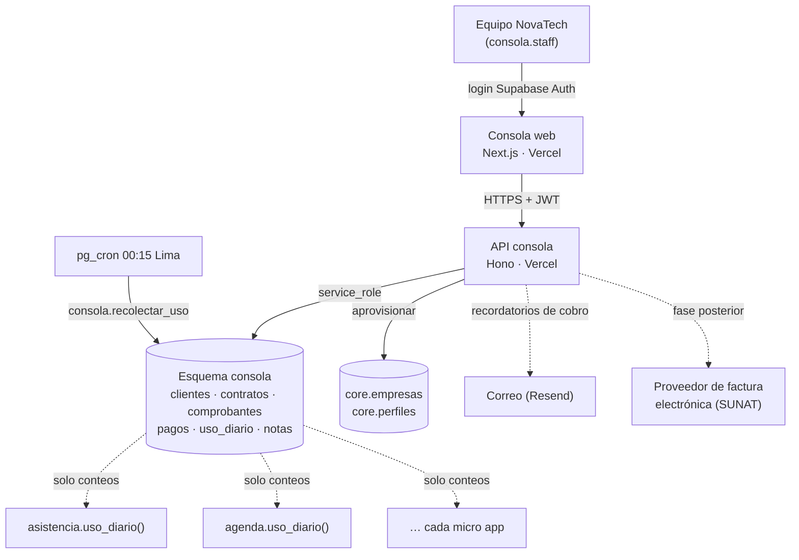

# 02 · Arquitectura — Consola NovaTech



## Cómo llegan los datos de uso

Cada micro app publica **una función SQL** con la misma firma:

```sql
<esquema>.uso_diario(p_fecha date) returns table (empresa_id uuid, metrica text, valor bigint)
```

`consola.recolectar_uso(fecha)` recorre `consola.productos`, llama a la función de cada esquema que exista y guarda el resultado en `consola.uso_diario` (idempotente: si se ejecuta dos veces, actualiza). Un `pg_cron` lo dispara cada noche.

**Métricas mínimas que toda micro app debe reportar:**

| Métrica | Significado |
|---|---|
| `usuarios_activos` | Usuarios distintos con actividad ese día |
| `mensajes_whatsapp` | Mensajes enviados (si la app usa WhatsApp) |
| Métrica principal de la app | p. ej. `marcaciones`, `citas`, `pedidos`, `entregas` |

> Regla para el área de desarrollo: **al construir cada micro app, su migración debe incluir `uso_diario()`**. La de Asistencia ya está en el borrador de la consola como ejemplo.

## Decisiones

| # | Decisión | Motivo |
|---|---|---|
| ADR-C1 | Esquema `consola` en el **mismo proyecto Supabase** | Sin costo extra; acceso directo a `core` y a las funciones de uso |
| ADR-C2 | Sin acceso de clientes (RLS sin políticas, sin `grant` a `authenticated`) | Los datos comerciales de NovaTech nunca se exponen |
| ADR-C3 | Recolección en SQL (pg_cron) en vez de que cada app "envíe" datos | Más simple, sin endpoints extra, idempotente |
| ADR-C4 | La consola registra comprobantes; la emisión electrónica se integra después | Prioridad: vender antes que automatizar |
| ADR-C5 | Personal en `consola.staff`, separado de `core.perfiles` | El personal de NovaTech no pertenece a ninguna empresa cliente |
