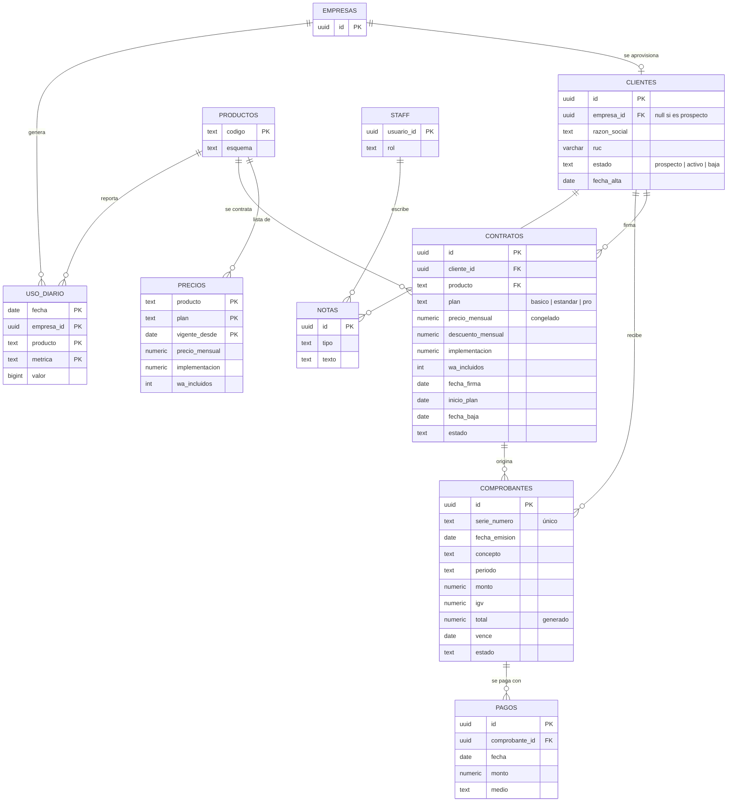

# 03 · Modelo de datos (borrador) — Consola NovaTech

SQL: [`database/borrador/20261008000001_consola.sql`](../database/borrador/20261008000001_consola.sql) — **validado en PostgreSQL 16** con datos de prueba (indicadores, recolector de uso y bloqueo de acceso a usuarios de clientes).

## Funciones

| Función | Devuelve |
|---|---|
| `consola.mrr(fecha)` | Ingreso mensual recurrente a esa fecha |
| `consola.kpis(fecha)` | Clientes activos, prospectos, contratos hoy/mes, bajas, recurrente, facturado hoy/mes, cobrado, por cobrar, vencido |
| `consola.recolectar_uso(fecha)` | Número de filas de uso guardadas |
| `asistencia.uso_diario(fecha)` | Ejemplo de contrato de uso (marcaciones, usuarios activos, locales activos) |
