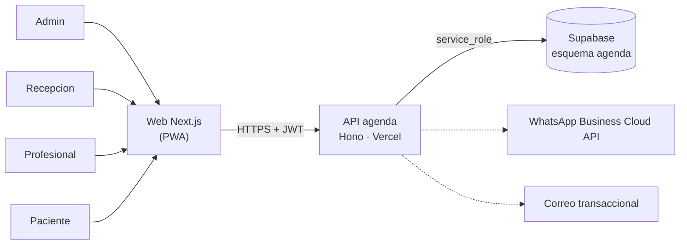

# 02 · Arquitectura — Agenda de citas + recordatorios WhatsApp

Misma plataforma que todas las micro apps (ver [`GUIA-DESARROLLO.md`](../../GUIA-DESARROLLO.md) y la arquitectura de referencia en [`03-asistencia-rrhh/docs/02-arquitectura.md`](../../03-asistencia-rrhh/docs/02-arquitectura.md)).

## Componentes

| Componente | Tecnología | Despliegue |
|---|---|---|
| API | Hono + Zod + supabase-js | Vercel `agenda-citas-api` |
| Web | Next.js + Tailwind | Vercel `agenda-citas-web` |
| Móvil | PWA (la misma web) | — |
| Datos | PostgreSQL, esquema `agenda` | Supabase `produccion-compartida` |

## Decisiones

- Lógica de negocio en el **backend**; los clientes solo leen/escriben a través de la API.
- No se construye app nativa. La interfaz web es **responsive e instalable (PWA)** desde el navegador del celular; cubre las necesidades de esta micro app sin pasar por tiendas.
- Integraciones: WhatsApp Business Cloud API (plantillas de utilidad, webhook), Correo transaccional (Resend).
