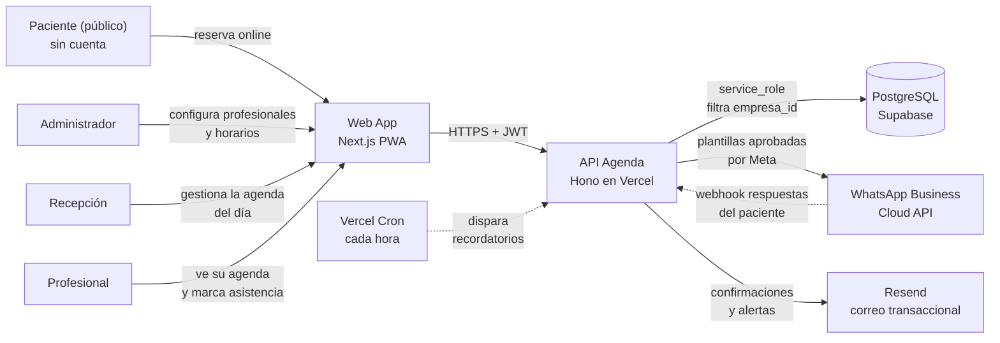
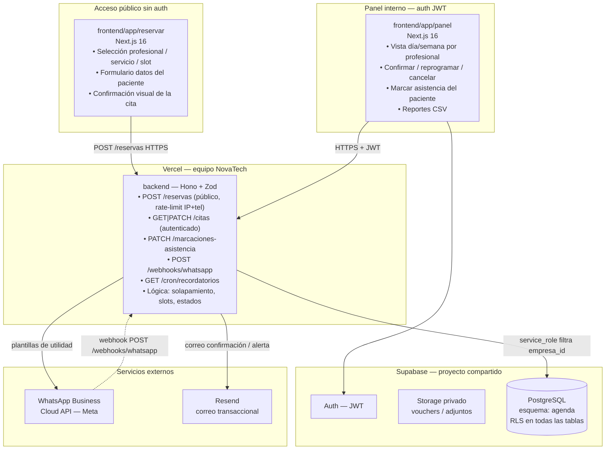
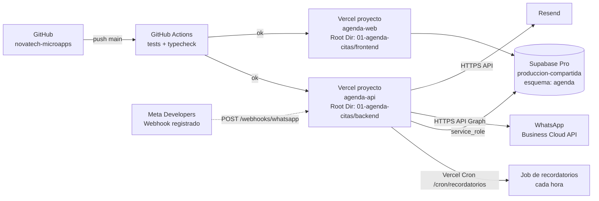

# 02 · Arquitectura — Agenda de Citas + Recordatorios WhatsApp

Los diagramas usan **Mermaid** (se ven directamente en GitHub y en VS Code con la extensión "Markdown Preview Mermaid Support").

## 1. Contexto (C1)



## 2. Contenedores (C2)



**Principio clave:** la página pública de reserva nunca escribe directo a Supabase; la API valida disponibilidad del slot con `SELECT FOR UPDATE`, aplica rate limit por IP y teléfono, y registra la cita en una transacción atómica.

## 3. Secuencia principal: reserva y ciclo de recordatorio

```mermaid
sequenceDiagram
    autonumber
    actor P as Paciente
    participant Web as Web pública (Next.js)
    participant API as API (Hono)
    participant DB as PostgreSQL
    participant WA as WhatsApp (Meta)

    P->>Web: Abre enlace de reserva del consultorio
    Web->>API: GET /reservas/slots?profesional=X&fecha=Y
    API->>DB: consulta horarios, bloqueos y citas existentes
    DB-->>API: slots disponibles
    API-->>Web: lista de bloques libres
    P->>Web: Selecciona slot y completa nombre y teléfono
    Web->>API: POST /reservas {nombre, telefono, servicio_id, slot}
    API->>API: verifica rate-limit por IP y por teléfono
    alt límite excedido
        API-->>Web: 429 Demasiadas solicitudes
    else dentro del límite
        API->>DB: BEGIN — SELECT slot FOR UPDATE
        alt slot ya tomado por otra reserva concurrente
            API-->>Web: 409 Slot no disponible
        else slot libre
            API->>DB: INSERT cita + INSERT log_envio_wa (pendiente)
            API->>DB: COMMIT
            API->>WA: plantilla confirmacion_cita (nombre, fecha, hora Lima)
            WA-->>API: message_id
            API->>DB: UPDATE log_envio_wa estado=enviado
            API-->>Web: 201 Cita confirmada
            Web-->>P: Pantalla con detalles y botón añadir al calendario
        end
    end

    Note over API,DB: Cron cada hora — ventana de recordatorio
    API->>DB: SELECT citas donde recordatorio_enviado=false AND inicio <= now()+24h
    DB-->>API: lista de citas pendientes de recordatorio
    API->>WA: plantilla recordatorio_cita (24h antes; 2h si cita < 24h)
    WA-->>P: WhatsApp con opciones 1-Confirmar 2-Cancelar 3-Reprogramar
    P->>WA: responde "1"
    WA->>API: POST /webhooks/whatsapp {from, body}
    API->>DB: UPDATE cita SET estado='confirmada', recordatorio_enviado=true
    API-->>WA: 200 OK
```

## 4. Diagrama de despliegue



| Componente | Proyecto Vercel | Dominio sugerido |
|---|---|---|
| API | `agenda-api` (Root Dir: `01-agenda-citas/backend`) | `api-agenda.novatechconsulting.com.pe` |
| Web / PWA | `agenda-web` (Root Dir: `01-agenda-citas/frontend`) | `agenda.novatechconsulting.com.pe` |
| Base de datos | Supabase `produccion-compartida` (esquema `agenda`) | — |

## 5. Decisiones de arquitectura (ADR)

| # | Decisión | Alternativas | Motivo |
|---|---|---|---|
| ADR-01 | Validación de solapamiento en el servidor con `SELECT FOR UPDATE` | Validar solo en frontend o índice UNIQUE en BD | El frontend es manipulable; dos reservas concurrentes sobre el mismo slot solo se resuelven sin carrera con un lock de fila en la transacción del servidor. |
| ADR-02 | Página pública sin autenticación con rate limit por IP y teléfono | Requerir cuenta para reservar | El paciente no crea cuenta; barreras de registro reducen conversión. El rate limit en middleware es la capa anti-spam suficiente según RNF-09. |
| ADR-03 | Cron de Vercel (cada hora) para recordatorios | pg_cron en Supabase | Visible en logs de Vercel, pausable sin tocar la BD, no requiere extensión adicional. pg_cron queda como alternativa si se necesita precisión al minuto. |
| ADR-04 | Solo plantillas de utilidad aprobadas por Meta | Mensajes de sesión libres o plantillas de marketing | Las de utilidad tienen costo fijo predecible y no requieren que el paciente haya iniciado conversación en las últimas 24 h. Cumple RN-03 y R9. |
| ADR-05 | Webhook de WhatsApp para procesar respuestas del paciente | Polling a la API de Meta | Push en tiempo real sin costo de llamadas repetidas; latencia menor a 2 s frente a minutos con polling. |
| ADR-06 | Hora guardada en UTC, visualización en America/Lima | Guardar directo en zona Lima | Evita ambigüedad si Perú cambia horario de verano; facilita comparaciones y ordenamientos. Cumple R3. |
| ADR-07 | Un esquema por app (`agenda`) en Supabase compartido | Proyecto Supabase separado por app | Cada proyecto adicional cuesta ~US$10/mes; el esquema separado mantiene aislamiento con RLS y costo bajo. Cumple R7. |

## 6. Estructura de código

```
01-agenda-citas/
├── backend/
│   ├── api/index.ts                   # entrada Vercel (handler)
│   ├── src/
│   │   ├── app.ts                     # Hono: CORS, auth, rutas, errores globales
│   │   ├── domain/                    # lógica PURA sin dependencias de I/O
│   │   │   ├── slots.ts               # calcular disponibilidad de bloques
│   │   │   ├── recordatorio.ts        # regla 24h / 2h antes
│   │   │   └── estado-cita.ts         # máquina de estados y transiciones válidas
│   │   ├── services/                  # casos de uso: crearReserva, procesarRespuestaWA
│   │   ├── repos/                     # CitaRepo, EnvioWARepo (interfaz + impl Supabase)
│   │   ├── routes/
│   │   │   ├── reservas.ts            # POST /reservas (público con rate-limit)
│   │   │   ├── citas.ts               # CRUD autenticado
│   │   │   ├── webhooks.ts            # POST /webhooks/whatsapp
│   │   │   └── cron.ts                # GET /cron/recordatorios
│   │   ├── middleware/
│   │   │   ├── auth.ts                # JWT → perfil (empresa_id, rol)
│   │   │   └── rate-limit.ts          # límite por IP y teléfono
│   │   └── lib/                       # supabase-client, whatsapp, resend, zod-schemas
│   └── tests/                         # Vitest — dominio y servicios
├── frontend/
│   ├── app/
│   │   ├── reservar/                  # ruta pública sin layout de auth
│   │   └── (panel)/                   # layout autenticado
│   │       ├── agenda/                # vista día / semana
│   │       ├── pacientes/
│   │       └── configuracion/
│   ├── components/                    # CalendarioSemana, SlotPicker, ui/
│   └── lib/                           # api-client, sesion, formato-fecha-lima
└── database/
    ├── migrations/20261008000100_agenda.sql
    ├── seed.sql
    └── tests/rls_agenda.test.sql
```
