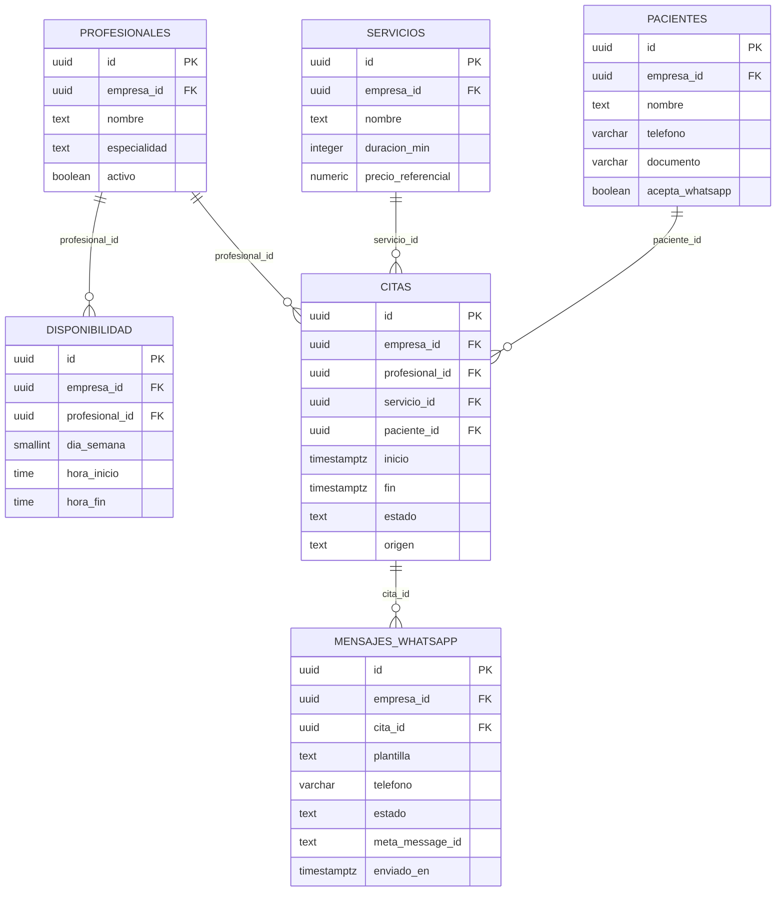

# 03 · Modelo de datos (borrador) — Agenda de citas + recordatorios WhatsApp

Esquema `agenda`. Todas las tablas incluyen `id`, `empresa_id` y `creado_en`. SQL: [`database/borrador/20261008000100_agenda.sql`](../database/borrador/20261008000100_agenda.sql).

## Pendiente al construir

- Políticas RLS por rol (el borrador solo filtra por empresa).
- Índices para las consultas de reportes.
- Restricciones `unique` de negocio (p. ej. numeración por empresa).
