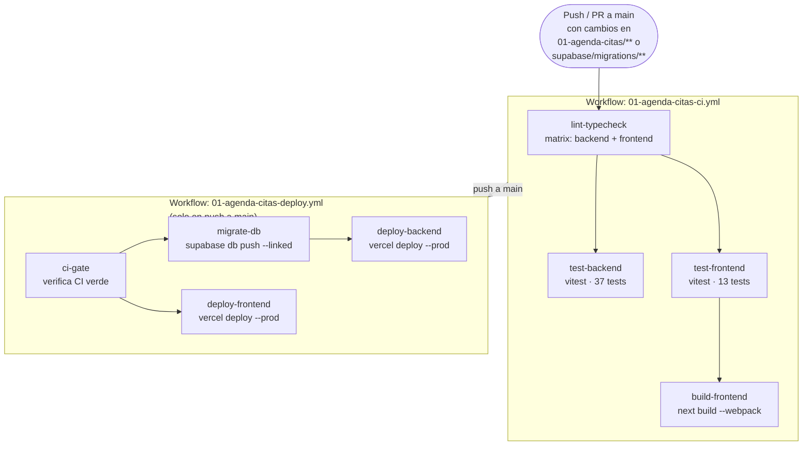

# Pipeline CI/CD — App 01 Agenda de Citas + Recordatorios WhatsApp

## 1. Arquitectura del pipeline



### Reglas de dependencia

| Job | Depende de | Razón |
|---|---|---|
| `test-backend` | `lint-typecheck` | No vale testear si el tipo no compila |
| `test-frontend` | `lint-typecheck` | Idem |
| `build-frontend` | `test-frontend` | El build es la puerta final de CI |
| `ci-gate` | — | Primero en Deploy, verifica que CI pasó |
| `migrate-db` | `ci-gate` | Schema debe actualizarse antes del nuevo código |
| `deploy-backend` | `migrate-db` | El backend nuevo puede requerir el schema nuevo |
| `deploy-frontend` | `ci-gate` | Independiente de DB, puede ir en paralelo con deploy-backend |

---

## 2. Secrets requeridos en GitHub

Configurar en: `Settings → Secrets and variables → Actions → New repository secret`

| Nombre del secret | Descripción | Cómo obtener |
|---|---|---|
| `VERCEL_TOKEN` | Token de autenticación personal de Vercel | Vercel Dashboard → Settings → Tokens → Create |
| `VERCEL_ORG_ID` | ID de la organización/equipo en Vercel | `vercel whoami` o Settings → General → Team ID |
| `VERCEL_PROJECT_ID_AGENDA_BACKEND` | ID del proyecto Vercel del backend | Ver paso 3 de esta guía |
| `VERCEL_PROJECT_ID_AGENDA_FRONTEND` | ID del proyecto Vercel del frontend | Ver paso 3 de esta guía |
| `SUPABASE_ACCESS_TOKEN` | Token personal de Supabase CLI | supabase.com → Account → Access Tokens → Generate |
| `SUPABASE_PROJECT_REF_AGENDA` | Referencia del proyecto Supabase (26 chars) | Supabase Dashboard → Project Settings → General → Reference ID |

> Ninguno de estos valores debe aparecer en código, YAML de workflow, ni archivos `.env` commiteados. El acceso a todos es mediante `${{ secrets.NOMBRE }}` exclusivamente.

---

## 3. Configurar proyectos en Vercel

### 3.1 Backend (Hono + Node 22)

1. Instalar Vercel CLI localmente: `npm i -g vercel`
2. Desde la raíz del monorepo, ejecutar dentro de `01-agenda-citas/backend/`:

```bash
cd 01-agenda-citas/backend
vercel link
```

3. Seleccionar o crear un nuevo proyecto (nombre sugerido: `novatech-agenda-backend`).
4. Cuando pregunte "In which directory is your code located?", confirmar `./` (ya estás dentro de `backend/`).
5. Vercel detectará automáticamente el framework como "Other". Ajustar manualmente:
   - **Build Command**: `npm run build` (si existe) o dejar vacío — el entry point es `api/index.ts`
   - **Output Directory**: dejar vacío
   - **Install Command**: `npm ci`
   - **Node.js Version**: 22.x
6. Obtener el Project ID: `cat .vercel/project.json` — copiar el valor de `projectId` como secret `VERCEL_PROJECT_ID_AGENDA_BACKEND`.
7. Obtener el Org ID: el campo `orgId` del mismo archivo, o desde `vercel whoami`.

**Variables de entorno de producción (backend)** — configurar en Vercel Dashboard → Project → Settings → Environment Variables:

| Variable | Environment | Descripción |
|---|---|---|
| `SUPABASE_URL` | Production | URL del proyecto Supabase (ej. `https://xxxx.supabase.co`) |
| `SUPABASE_SERVICE_ROLE_KEY` | Production | Service role key (nunca la anon key en el backend) |
| `TWILIO_ACCOUNT_SID` | Production | SID de la cuenta Twilio para WhatsApp |
| `TWILIO_AUTH_TOKEN` | Production | Auth token de Twilio |
| `TWILIO_WHATSAPP_FROM` | Production | Número Twilio con formato `whatsapp:+14155238886` |
| `APP_URL` | Production | URL pública del frontend (para CORS) |

### 3.2 Frontend (Next.js 16)

1. Desde la raíz del monorepo, ejecutar dentro de `01-agenda-citas/frontend/`:

```bash
cd 01-agenda-citas/frontend
vercel link
```

2. Seleccionar o crear un nuevo proyecto (nombre sugerido: `novatech-agenda-frontend`).
3. Vercel detectará el framework como Next.js automáticamente.
4. Ajustar:
   - **Build Command**: `npm run build` (incluye `--webpack` definido en `package.json`)
   - **Node.js Version**: 22.x
5. Obtener el Project ID: `cat .vercel/project.json` → copiar `projectId` como secret `VERCEL_PROJECT_ID_AGENDA_FRONTEND`.

**Variables de entorno de producción (frontend)** — configurar en Vercel Dashboard:

| Variable | Environment | Descripción |
|---|---|---|
| `NEXT_PUBLIC_SUPABASE_URL` | Production, Preview | URL pública del proyecto Supabase |
| `NEXT_PUBLIC_SUPABASE_ANON_KEY` | Production, Preview | Anon key (solo lectura con RLS activo) |
| `NEXT_PUBLIC_API_URL` | Production | URL del backend desplegado en Vercel |

> Para Preview Deployments, usar valores que apunten a un proyecto Supabase de staging, nunca al de producción.

---

## 4. Linkear el proyecto Supabase al repo

1. Asegurarse de tener Supabase CLI instalado: `npx supabase --version`
2. Autenticarse: `npx supabase login` (abrirá el navegador).
3. Desde la raíz del monorepo:

```bash
npx supabase link --project-ref <SUPABASE_PROJECT_REF_AGENDA>
```

4. Verificar que el archivo `supabase/.temp/project-ref` contiene el ref correcto.
5. Probar que el push funciona localmente antes de confiar en el pipeline:

```bash
npx supabase db push --linked
```

6. El ref del proyecto también se necesita como secret `SUPABASE_PROJECT_REF_AGENDA` (ver sección 2).

---

## 5. Variables de entorno de producción — resumen completo

### Backend (Vercel Environment Variables)

```
SUPABASE_URL                = https://<ref>.supabase.co
SUPABASE_SERVICE_ROLE_KEY   = <service-role-key>
TWILIO_ACCOUNT_SID          = AC...
TWILIO_AUTH_TOKEN           = <token>
TWILIO_WHATSAPP_FROM        = whatsapp:+14155238886
APP_URL                     = https://<dominio-frontend>.vercel.app
```

### Frontend (Vercel Environment Variables)

```
NEXT_PUBLIC_SUPABASE_URL      = https://<ref>.supabase.co
NEXT_PUBLIC_SUPABASE_ANON_KEY = <anon-key>
NEXT_PUBLIC_API_URL           = https://<dominio-backend>.vercel.app
```

---

## 6. Cómo hacer rollback ante un deploy fallido

### Rollback del frontend o backend (Vercel)

1. Abrir Vercel Dashboard → seleccionar el proyecto correspondiente.
2. Ir a "Deployments" → localizar el último deploy con estado "Ready" antes del fallido.
3. Hacer clic en los tres puntos (···) → "Promote to Production".
4. El deployment anterior queda activo en segundos, sin redeployar.

Via CLI (más rápido si ya lo tienes instalado):

```bash
# Listar deployments recientes
vercel ls --scope <org>

# Promover un deployment anterior a producción
vercel promote <deployment-url> --scope <org>
```

### Rollback de migraciones (Supabase)

Supabase no soporta rollback automático de migraciones. La estrategia correcta es:

1. Escribir siempre migraciones compatibles hacia atrás ("backward-compatible") — añadir columnas como nullable, nunca eliminar columnas en el mismo commit que las deja de usar el código.
2. Si una migración rompió algo, crear una nueva migración que revierta el cambio (no eliminar la migración original del historial).
3. Para casos críticos, acceder a Supabase Dashboard → SQL Editor y ejecutar el SQL de reversión manualmente, luego agregar esa reversión como migración versionada.

---

## 7. Estrategia de ramas

| Rama | Ambiente | Deploy | Supabase |
|---|---|---|---|
| `main` | Producción | Automático al hacer merge | Proyecto de producción |
| `develop` | Staging | Preview Deployment de Vercel por cada push | Proyecto Supabase separado (staging) |
| `feature/*` | Feature | Preview Deployment de Vercel por PR | No aplica (tests solo en CI) |

### Flujo recomendado

```
feature/mi-cambio  →  PR a develop  →  merge a develop  →  QA en staging
                                                         ↓
                                          PR de develop a main
                                                         ↓
                                         merge a main → deploy a producción
                                                         ↓
                                         pipeline CI → migrate-db → deploy
```

### Protección de ramas

Configurar en GitHub (`Settings → Branches → Branch protection rules`):

- **`main`**: requerir PR, requerir que el CI workflow (`01-agenda-citas-ci.yml`) pase, al menos 1 aprobación, no permitir push directo.
- **`develop`**: requerir que el CI workflow pase (opcional, según madurez del equipo).
