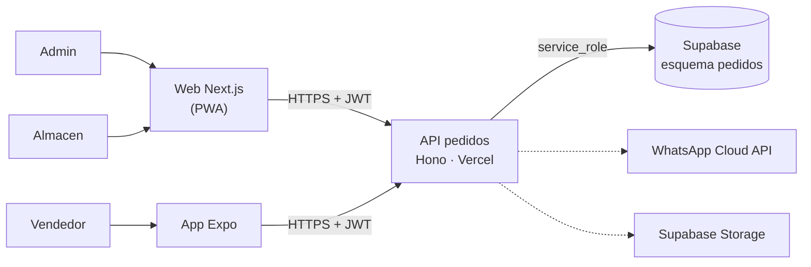

# 02 · Arquitectura — Toma de pedidos en ruta + cobranzas

Misma plataforma que todas las micro apps (ver [`GUIA-DESARROLLO.md`](../../GUIA-DESARROLLO.md) y la arquitectura de referencia en [`03-asistencia-rrhh/docs/02-arquitectura.md`](../../03-asistencia-rrhh/docs/02-arquitectura.md)).

## Componentes

| Componente | Tecnología | Despliegue |
|---|---|---|
| API | Hono + Zod + supabase-js | Vercel `pedidos-cobranzas-api` |
| Web | Next.js + Tailwind | Vercel `pedidos-cobranzas-web` |
| Móvil | Expo (React Native) | EAS Build |
| Datos | PostgreSQL, esquema `pedidos` | Supabase `produccion-compartida` |

## Decisiones

- Lógica de negocio en el **backend**; los clientes solo leen/escriben a través de la API.
- Se construye app **Expo** (patrón de la app 03) porque requiere **trabajo sin conexión** (SQLite local con `expo-sqlite`), cámara para vouchers y GPS de visitas.
- Integraciones: WhatsApp Cloud API (recordatorio de deuda), Supabase Storage (fotos de productos y vouchers).
