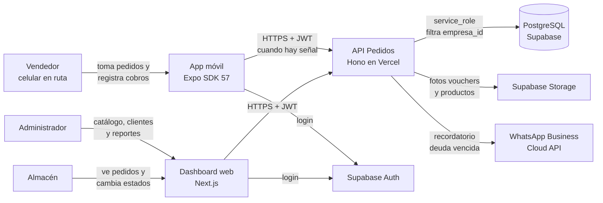
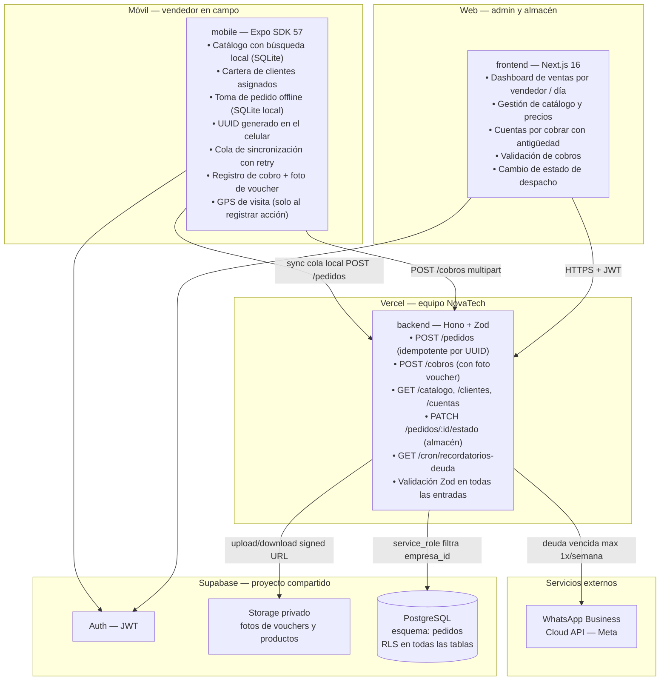
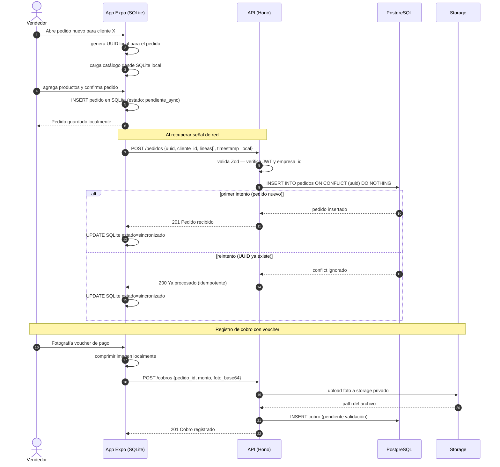
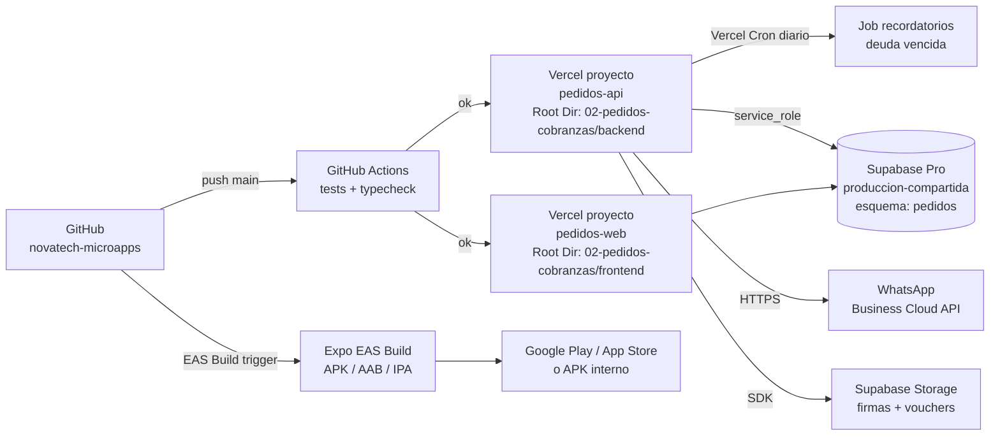

# 02 · Arquitectura — Toma de Pedidos en Ruta + Cobranzas

Los diagramas usan **Mermaid** (se ven directamente en GitHub y en VS Code con la extensión "Markdown Preview Mermaid Support").

## 1. Contexto (C1)



## 2. Contenedores (C2)



**Principio clave:** el UUID del pedido lo genera el celular antes de tener señal; la API aplica idempotencia con `INSERT ... ON CONFLICT (uuid) DO NOTHING`, garantizando que reintentos de sincronización no dupliquen pedidos.

## 3. Secuencia principal: toma de pedido offline y sincronización



## 4. Diagrama de despliegue



| Componente | Proyecto Vercel | Dominio sugerido |
|---|---|---|
| API | `pedidos-api` (Root Dir: `02-pedidos-cobranzas/backend`) | `api-pedidos.novatechconsulting.com.pe` |
| Dashboard web | `pedidos-web` (Root Dir: `02-pedidos-cobranzas/frontend`) | `pedidos.novatechconsulting.com.pe` |
| Base de datos | Supabase `produccion-compartida` (esquema `pedidos`) | — |
| App móvil | Expo EAS · paquete `pe.com.novatechconsulting.pedidos` | — |

## 5. Decisiones de arquitectura (ADR)

| # | Decisión | Alternativas | Motivo |
|---|---|---|---|
| ADR-01 | **UUID generado en el celular** como clave del pedido | ID autoincremental generado en el servidor | El celular está offline cuando se crea el pedido; el UUID permite identificar unívocamente el registro antes de sincronizar y aplicar idempotencia en el servidor con `ON CONFLICT DO NOTHING`. |
| ADR-02 | **App Expo nativa** (no PWA) | PWA con Service Worker y IndexedDB | `expo-sqlite` ofrece una base de datos relacional real en el dispositivo, soporte de transacciones y rendimiento superior a IndexedDB para catálogos de cientos de productos y offline hasta 8 h (RNF-08). |
| ADR-03 | **SQLite local** para catálogo y cola de pedidos | Solo memoria en React Native | La memoria se pierde al matar la app; SQLite persiste entre sesiones y permite búsquedas eficientes sin red. |
| ADR-04 | **Fotos de vouchers en Storage privado** con URL firmada | Guardar fotos en la BD como BYTEA | Storage es más barato, no infla la BD, y permite URLs firmadas de duración controlada para visualización por el admin. |
| ADR-05 | **Recordatorio de deuda máximo 1 vez/semana por cliente** via WhatsApp | Sin límite de frecuencia | Respetar al receptor reduce bloqueos de número; cumple RN-04 y la regla R9 (WhatsApp solo para alertas). |
| ADR-06 | **GPS solo al registrar la visita** (no rastreo continuo) | Rastreo en segundo plano | Batería, privacidad (Ley 29733) y aprobación en tiendas. Cumple R8. |
| ADR-07 | **Un esquema por app** (`pedidos`) en Supabase compartido | Proyecto Supabase separado | Costo ~US$10/mes por proyecto adicional; el esquema con RLS provee aislamiento multi-tenant suficiente. Cumple R7. |

## 6. Estructura de código

```
02-pedidos-cobranzas/
├── backend/
│   ├── api/index.ts                   # entrada Vercel
│   ├── src/
│   │   ├── app.ts                     # Hono: CORS, auth, rutas, errores
│   │   ├── domain/                    # lógica PURA sin I/O
│   │   │   ├── pedido.ts              # cálculo de totales, aplicar lista de precios
│   │   │   ├── cuentas-cobrar.ts      # saldo = crédito − cobros validados
│   │   │   └── idempotencia.ts        # verificar UUID duplicado
│   │   ├── services/                  # crearPedido, registrarCobro, sincronizarCola
│   │   ├── repos/                     # PedidoRepo, CobrosRepo, ClienteRepo
│   │   ├── routes/
│   │   │   ├── pedidos.ts             # POST /pedidos (idempotente)
│   │   │   ├── cobros.ts              # POST /cobros multipart
│   │   │   ├── catalogo.ts            # GET /catalogo (para sync móvil)
│   │   │   ├── clientes.ts            # GET /clientes (cartera por vendedor)
│   │   │   └── cron.ts                # GET /cron/recordatorios-deuda
│   │   ├── middleware/auth.ts         # JWT → perfil con rol
│   │   └── lib/                       # supabase, storage, whatsapp, zod-schemas
│   └── tests/
├── frontend/
│   ├── app/(panel)/
│   │   ├── dashboard/                 # tablero ventas por vendedor / día
│   │   ├── pedidos/                   # listado y detalle
│   │   ├── cobros/                    # validación de vouchers
│   │   ├── cuentas-cobrar/            # antigüedad de deuda
│   │   └── catalogo/                  # gestión de productos y precios
│   ├── components/                    # TablaDeuda, GraficaVentas, ui/
│   └── lib/                           # api-client, sesion, formato
├── mobile/
│   ├── App.tsx                        # sesión + navegación
│   └── src/
│       ├── screens/                   # ClientesScreen, PedidoScreen, CobrosScreen
│       ├── db/                        # esquema SQLite, migraciones locales
│       ├── sync/                      # cola de sincronización con retry
│       └── lib/                       # api-client, compresion-foto, gps
└── database/
    ├── migrations/20261008000200_pedidos.sql
    ├── seed.sql
    └── tests/rls_pedidos.test.sql
```
