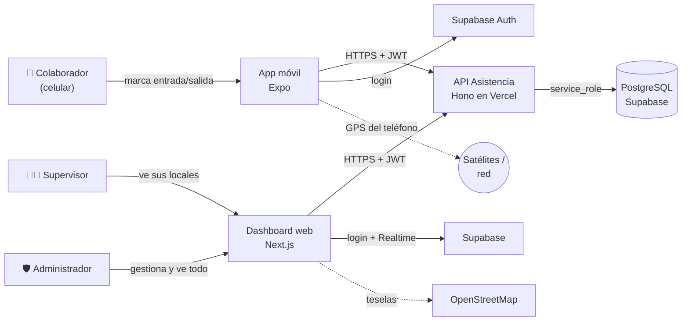
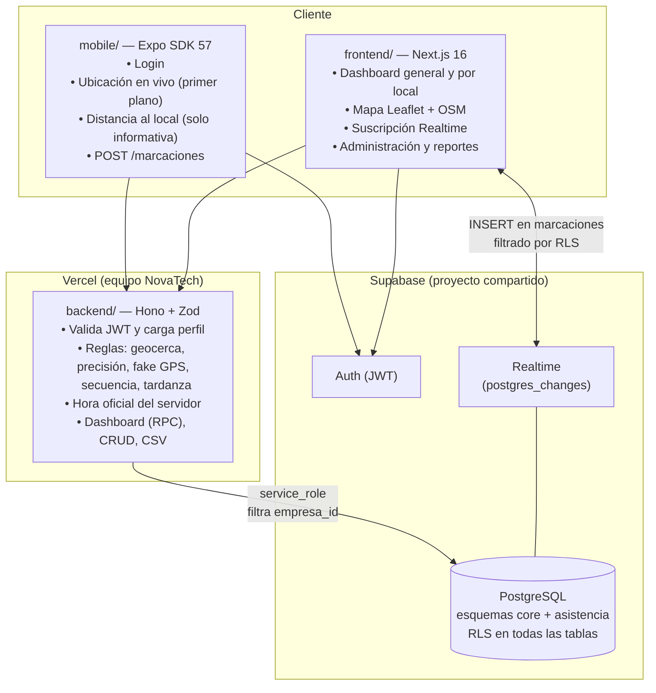
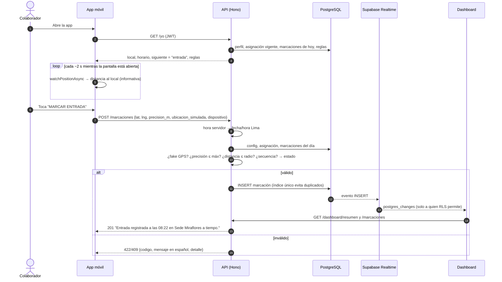
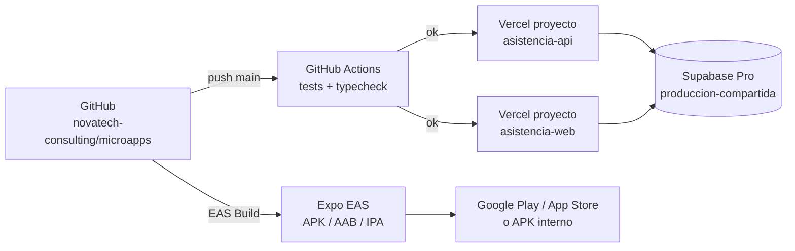

# 02 · Arquitectura — Asistencia

Los diagramas usan **Mermaid** (se ven directamente en GitHub y en VS Code con la extensión "Markdown Preview Mermaid Support").

## 1. Contexto



## 2. Contenedores y responsabilidades



**Principio clave:** el celular **nunca decide** si la marcación es válida. Envía su posición y el **backend** recalcula la distancia, verifica precisión, ubicación simulada, secuencia del día y hora. Los clientes no tienen permisos de escritura en la base de datos (RLS sin políticas de INSERT).

## 3. Secuencia: marcar entrada



## 4. Despliegue



| Componente | Proyecto | Dominio sugerido |
|---|---|---|
| API | Vercel `asistencia-api` (Root Directory: `03-asistencia-rrhh/backend`) | `api-asistencia.novatechconsulting.com.pe` |
| Dashboard | Vercel `asistencia-web` (Root Directory: `03-asistencia-rrhh/frontend`) | `asistencia.novatechconsulting.com.pe` |
| Base de datos | Supabase `produccion-compartida` (esquemas `core`, `asistencia`) | — |
| App | Expo EAS · paquete `pe.com.novatechconsulting.asistencia` | — |

## 5. Decisiones de arquitectura (ADR)

| # | Decisión | Alternativas | Motivo |
|---|---|---|---|
| ADR-01 | Validación de geocerca **en el servidor** | Solo en el celular | El cliente es manipulable; el servidor es la única fuente de verdad. |
| ADR-02 | **App nativa con Expo** (no solo PWA) | PWA | `expo-location` expone `mocked` (detección de fake GPS en Android) y mejor precisión/permisos. |
| ADR-03 | **API propia (Hono)** con `service_role` | Clientes escribiendo directo a Supabase con RLS | Reglas complejas (hora servidor, secuencia, estados) en un solo lugar, probadas con unit tests. |
| ADR-04 | Geocerca **circular** con Haversine | Polígonos con PostGIS | Suficiente para locales urbanos; simple de configurar por el cliente. Polígonos quedan para Fase 2 si se requiere. |
| ADR-05 | **Supabase Realtime** para el dashboard + sondeo de respaldo cada 60 s | WebSocket propio, sondeo puro | Sin infraestructura extra; RLS filtra eventos por empresa/local. |
| ADR-06 | Un esquema por micro app (`asistencia`) dentro del **proyecto Supabase compartido** | Un proyecto por app | Costo: cada proyecto extra ≈ US$10/mes. Ver guía de desarrollo. |
| ADR-07 | **Hora del servidor** y `fecha_local` guardada | Hora del celular | Evita fraude cambiando la hora del teléfono; facilita consultas por día. |
| ADR-08 | Mapas con **OpenStreetMap + Leaflet** | Google Maps | Sin costo ni API key. Respetar la política de uso de teselas de OSM; si el tráfico crece, usar un proveedor de teselas. |
| ADR-09 | Sin rastreo en segundo plano | Seguimiento continuo | Privacidad (Ley 29733), batería y aprobación en tiendas. |

## 6. Estructura de código

```
03-asistencia-rrhh/
├── backend/
│   ├── api/index.ts               # entrada Vercel
│   ├── src/
│   │   ├── app.ts                 # Hono: CORS, auth, rutas, errores
│   │   ├── domain/                # funciones PURAS: geocerca, tiempo, reglas (100 % probadas)
│   │   ├── services/              # casos de uso: registrarMarcacion, estadoDelDia
│   │   ├── repos/                 # puerto MarcacionRepo + implementación Supabase
│   │   ├── routes/                # marcaciones, dashboard, locales, horarios, colaboradores, reportes
│   │   ├── middleware/auth.ts     # JWT → perfil (empresa, rol)
│   │   └── lib/                   # supabase, validación (Zod), errores, CSV, permisos
│   ├── scripts/seed-demo.ts
│   └── tests/                     # Vitest
├── frontend/
│   ├── app/login, app/(panel)/{dashboard,locales,colaboradores,reportes}
│   ├── components/                # KpiCard, Mapa (Leaflet), useTiempoReal, ui
│   └── lib/                       # api, supabase, sesión, formato
├── mobile/
│   ├── App.tsx                    # sesión + pestañas
│   └── src/{screens,hooks,lib,components}
└── database/
    ├── migrations/20261008000300_asistencia.sql
    ├── seed.sql
    └── tests/rls_asistencia.test.sql
```
