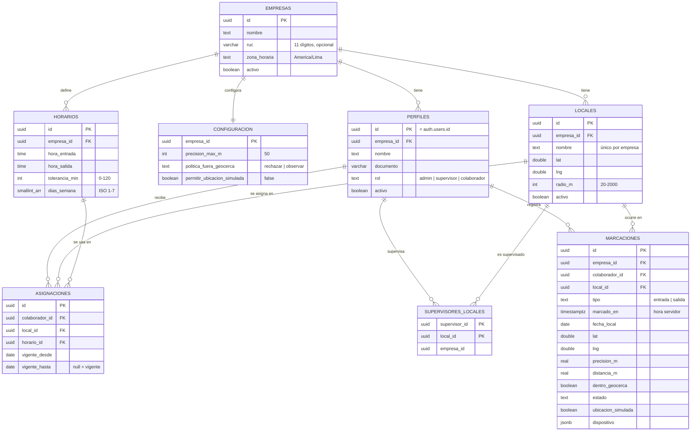

# 03 · Modelo de datos — Asistencia

Migraciones: [`plataforma/database/migrations/20261008000000_core.sql`](../../plataforma/database/migrations/20261008000000_core.sql) y [`database/migrations/20261008000300_asistencia.sql`](../database/migrations/20261008000300_asistencia.sql).

## Diagrama entidad-relación

## Esquemas

| Esquema | Propósito | Compartido |
|---|---|---|
| `core` | Empresas y perfiles (usuarios). | Sí, por todas las micro apps |
| `asistencia` | Tablas y funciones de esta micro app. | No |

## Índices y restricciones importantes

| Objeto | Para qué |
|---|---|
| `marcaciones_unica_por_dia_idx (colaborador_id, fecha_local, tipo)` UNIQUE | Imposible duplicar entrada o salida (doble toque, reintentos de red). |
| `marcaciones_local_fecha_idx (empresa_id, local_id, fecha_local)` | Dashboard por local y fecha. |
| `asignaciones_una_abierta_idx (colaborador_id) WHERE vigente_hasta IS NULL` UNIQUE | Una sola asignación vigente por colaborador. |
| `check radio_m between 20 and 2000` | Evita geocercas absurdas. |
| `check hora_salida > hora_entrada` | Turnos dentro del mismo día (Fase 1). |

## Funciones (solo `service_role`)

| Función | Devuelve |
|---|---|
| `asistencia.resumen_por_local(p_empresa, p_fecha, p_locales[])` | Una fila por local: programados, presentes, tardanzas, sin_marcar, salidas, observadas, lat/lng/radio. |
| `asistencia.detalle_local(p_empresa, p_local, p_fecha)` | Una fila por persona programada o que marcó: horario, entrada, salida, estados y situación. |

## Seguridad a nivel de fila (RLS)

| Tabla | Lectura permitida a `authenticated` | Escritura |
|---|---|---|
| `core.empresas` | Solo su empresa | Solo backend |
| `core.perfiles` | Perfiles de su empresa | Solo backend |
| `asistencia.locales`, `horarios`, `configuracion` | Su empresa | Solo backend |
| `asistencia.asignaciones` | Propias; admin todas; supervisor las de sus locales | Solo backend |
| `asistencia.marcaciones` | Propias; admin todas; supervisor las de sus locales | **Solo backend** |

Las políticas de `marcaciones` también filtran los eventos de **Realtime**: un supervisor solo recibe en vivo lo de sus locales.

## Retención de datos

Propuesta (confirmar con cada cliente en el contrato): conservar marcaciones **5 años** (sustento laboral) y luego anonimizar lat/lng. Ver [09-seguridad-privacidad.md](09-seguridad-privacidad.md).
