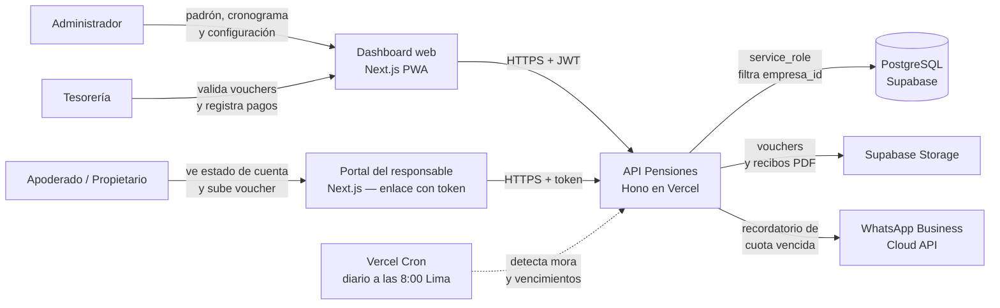
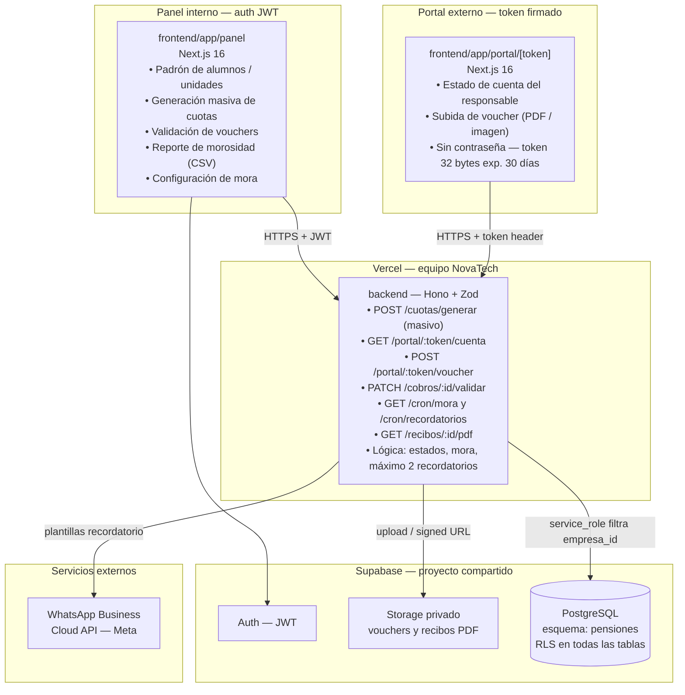
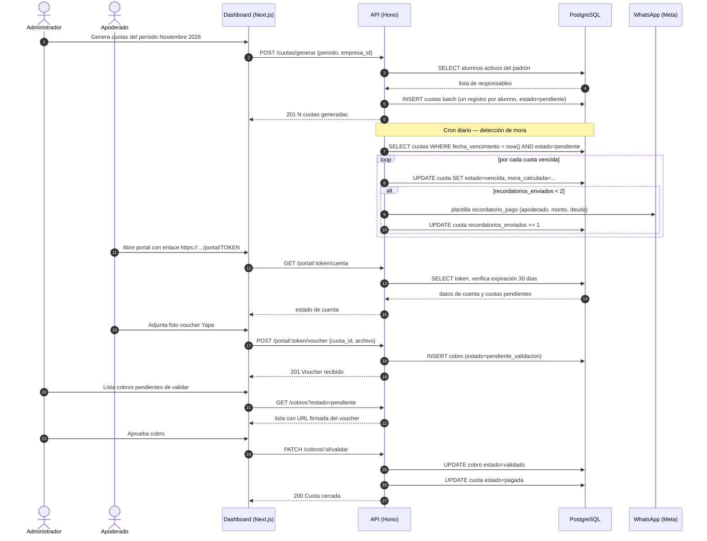
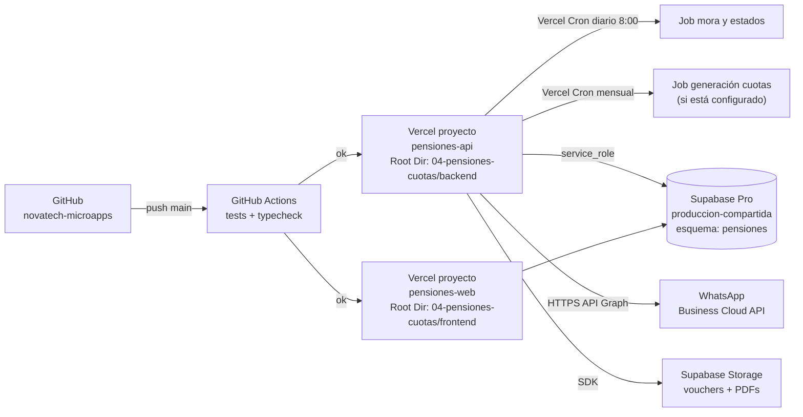

# 02 · Arquitectura — Control de Pensiones y Cuotas

Los diagramas usan **Mermaid** (se ven directamente en GitHub y en VS Code con la extensión "Markdown Preview Mermaid Support").

## 1. Contexto (C1)



## 2. Contenedores (C2)



**Principio clave:** el apoderado accede a su estado de cuenta con un token de 32 bytes sin contraseña; la API valida el token contra la BD, verifica expiración a 30 días y devuelve solo los datos de ese responsable, sin RLS bypass.

## 3. Secuencia principal: generación de cuotas, mora y pago



## 4. Diagrama de despliegue



| Componente | Proyecto Vercel | Dominio sugerido |
|---|---|---|
| API | `pensiones-api` (Root Dir: `04-pensiones-cuotas/backend`) | `api-pensiones.novatechconsulting.com.pe` |
| Dashboard / Portal | `pensiones-web` (Root Dir: `04-pensiones-cuotas/frontend`) | `pensiones.novatechconsulting.com.pe` |
| Base de datos | Supabase `produccion-compartida` (esquema `pensiones`) | — |

## 5. Decisiones de arquitectura (ADR)

| # | Decisión | Alternativas | Motivo |
|---|---|---|---|
| ADR-01 | **Portal del apoderado sin contraseña** con token de 32 bytes y expiración 30 días | Cuenta de usuario con contraseña | El apoderado promedio no recuerda otra contraseña; el token seguro enviado por WhatsApp/correo es usable y cumple RNF-08. Un token aleatorio de 32 bytes es inviable de adivinar por fuerza bruta. |
| ADR-02 | **Generación masiva de cuotas** como job en lote desde la API | Trigger en PostgreSQL al cambiar fecha | El job API permite logging, control de errores y auditoría clara. Los triggers son difíciles de monitorear y depurar. |
| ADR-03 | **Recibo PDF generado en el servidor** con `@react-pdf/renderer` | PDF en el cliente (navegador) | El servidor garantiza formato consistente y el archivo queda en Storage para descarga posterior; el cliente no necesita procesar el PDF. |
| ADR-04 | **Máximo 2 recordatorios por cuota** | Sin límite | Cumple RN-03; evita hostigamiento al apoderado y bloqueos del número de WhatsApp por spam. |
| ADR-05 | **Mora calculada en el servidor** al momento de ejecutar el cron | Calcular mora en el cliente | El servidor es la fuente de verdad; la mora puede depender de configuración por empresa (monto fijo o porcentaje), que solo el servidor conoce con certeza. |
| ADR-06 | **Vouchers en Storage privado** con URL firmada de visualización | Adjuntos en la BD como BYTEA | Storage es más barato, escalable, y las URLs firmadas controlan el acceso sin exponer el archivo directamente. Cumple RNF-09. |
| ADR-07 | **Un esquema por app** (`pensiones`) en Supabase compartido | Proyecto Supabase separado por app | Costo ~US$10/mes por proyecto adicional. RLS garantiza aislamiento multi-tenant. Cumple R7. |

## 6. Estructura de código

```
04-pensiones-cuotas/
├── backend/
│   ├── api/index.ts                   # entrada Vercel
│   ├── src/
│   │   ├── app.ts                     # Hono: CORS, auth, rutas, errores
│   │   ├── domain/
│   │   │   ├── cuota.ts               # estados, transiciones válidas
│   │   │   ├── mora.ts                # cálculo monto fijo o % por día
│   │   │   └── recordatorio.ts        # regla máximo 2 por cuota
│   │   ├── services/                  # generarCuotas, procesarMora, validarCobro
│   │   ├── repos/                     # CuotaRepo, CobroRepo, AlumnoRepo
│   │   ├── routes/
│   │   │   ├── cuotas.ts              # POST /cuotas/generar, GET listado
│   │   │   ├── portal.ts              # GET|POST /portal/:token/...
│   │   │   ├── cobros.ts              # PATCH /cobros/:id/validar
│   │   │   ├── recibos.ts             # GET /recibos/:id/pdf
│   │   │   └── cron.ts                # GET /cron/mora, /cron/recordatorios
│   │   ├── middleware/auth.ts         # JWT → perfil
│   │   └── lib/                       # supabase, whatsapp, pdf-renderer, zod
│   └── tests/
├── frontend/
│   ├── app/
│   │   ├── portal/[token]/            # portal público del apoderado
│   │   └── (panel)/
│   │       ├── padron/                # alumnos y responsables
│   │       ├── cuotas/                # cronograma y generación masiva
│   │       ├── cobros/                # validación de vouchers
│   │       └── reportes/              # morosidad por aula / antigüedad
│   ├── components/                    # TablaMorosidad, EstadoCuenta, ui/
│   └── lib/                           # api-client, sesion, formato
└── database/
    ├── migrations/20261008000400_pensiones.sql
    ├── seed.sql
    └── tests/rls_pensiones.test.sql
```
