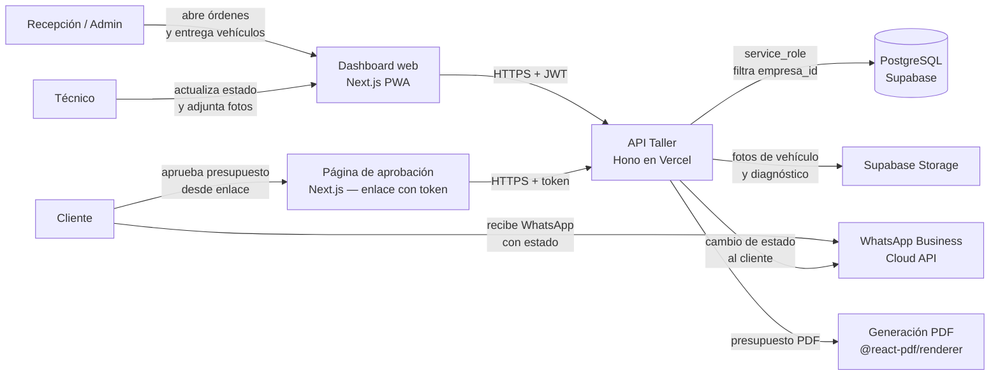
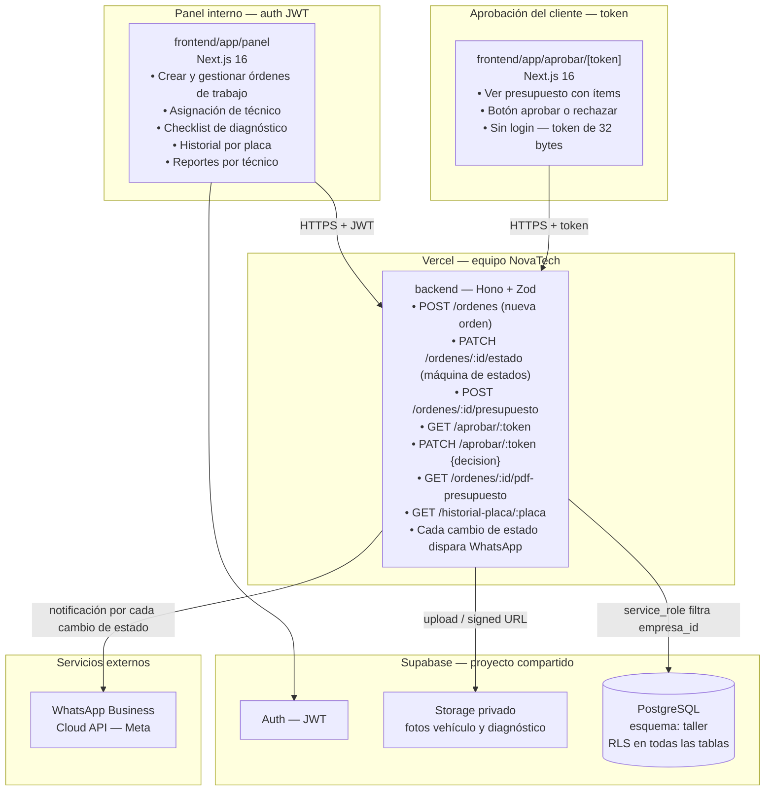
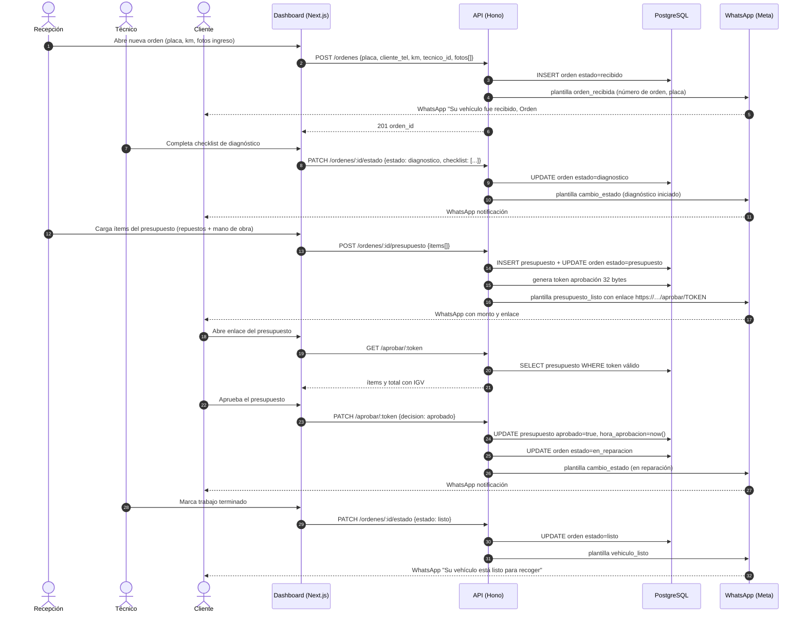

# 02 · Arquitectura — Orden de Trabajo con Estado por WhatsApp

Los diagramas usan **Mermaid** (se ven directamente en GitHub y en VS Code con la extensión "Markdown Preview Mermaid Support").

## 1. Contexto (C1)



## 2. Contenedores (C2)



**Principio clave:** la orden de trabajo es una máquina de estados estricta (recibido → diagnóstico → presupuesto → en reparación → listo → entregado); los estados solo avanzan y cada transición válida dispara automáticamente un WhatsApp al cliente, sin que el técnico o la recepción tengan que recordarlo.

## 3. Secuencia principal: ciclo completo de una orden de trabajo



## 4. Diagrama de despliegue

```mermaid
flowchart LR
    GH["GitHub\nnovatech-microapps"] -->|push main| CI["GitHub Actions\ntests + typecheck"]
    CI -->|ok| V1["Vercel proyecto\ntaller-api\nRoot Dir: 05-ordenes-taller/backend"]
    CI -->|ok| V2["Vercel proyecto\ntaller-web\nRoot Dir: 05-ordenes-taller/frontend"]
    V1 -->|service_role| SB[("Supabase Pro\nproduccion-compartida\nesquema: taller")]
    V2 --> SB
    V1 -->|HTTPS API Graph| WA["WhatsApp\nBusiness Cloud API"]
    V1 -->|SDK| ST["Supabase Storage\nfotos vehículo y diagnóstico"]
```



| Componente | Proyecto Vercel | Dominio sugerido |
|---|---|---|
| API | `taller-api` (Root Dir: `05-ordenes-taller/backend`) | `api-taller.novatechconsulting.com.pe` |
| Dashboard / Aprobación | `taller-web` (Root Dir: `05-ordenes-taller/frontend`) | `taller.novatechconsulting.com.pe` |
| Base de datos | Supabase `produccion-compartida` (esquema `taller`) | — |

## 5. Decisiones de arquitectura (ADR)

| # | Decisión | Alternativas | Motivo |
|---|---|---|---|
| ADR-01 | **Máquina de estados estricta en el backend** con transiciones válidas por tabla | Libre actualización de estado desde el frontend | La regla RN-02 exige que los estados solo avancen; el backend es el único punto que puede garantizar que no se salten pasos o retrocedan sin autorización de admin. |
| ADR-02 | **WhatsApp automático en cada transición de estado** desde el servicio de dominio | Notificación manual por el técnico o recepción | El humano olvida notificar; el disparo automático en cada `PATCH /ordenes/:id/estado` garantiza que el cliente siempre esté informado sin fricción adicional. |
| ADR-03 | **Aprobación del cliente con token sin cuenta** | Requerir login del cliente | El cliente ya tiene el WhatsApp abierto; un enlace con token de 32 bytes es friccional mínimo y suficientemente seguro para una aprobación de presupuesto. |
| ADR-04 | **Presupuesto PDF generado en el servidor** con `@react-pdf/renderer` | PDF en navegador | El servidor garantiza formato con IGV consistente y el PDF queda en Storage para auditoría; cumple RF-04 con totales correctos. |
| ADR-05 | **No se puede pasar a "en reparación" sin presupuesto aprobado** (validado en el servidor) | Solo validación en el frontend | La lógica de negocio RN-01 no debe vivir en el cliente; el backend rechaza la transición con 422 si el presupuesto no fue aprobado. |
| ADR-06 | **Historial por placa** como índice en la BD | Búsqueda full-text | La placa es el identificador natural del vehículo en el dominio; un índice B-tree sobre `placa` es suficiente para recuperar el historial en O(log n). |
| ADR-07 | **Fotos comprimidas en el cliente** antes de subir (≤ 500 KB) | Comprimir en el servidor | Ahorra ancho de banda y tiempo de carga; el cliente web puede usar `canvas` para comprimir antes del POST. Cumple RNF-08. |

## 6. Estructura de código

```
05-ordenes-taller/
├── backend/
│   ├── api/index.ts                   # entrada Vercel
│   ├── src/
│   │   ├── app.ts                     # Hono: CORS, auth, rutas, errores
│   │   ├── domain/
│   │   │   ├── estado-orden.ts        # máquina de estados y transiciones válidas
│   │   │   ├── presupuesto.ts         # cálculo de subtotal e IGV
│   │   │   └── notificacion.ts        # plantilla WhatsApp por estado
│   │   ├── services/                  # crearOrden, cambiarEstado, aprobarPresupuesto
│   │   ├── repos/                     # OrdenRepo, PresupuestoRepo, VehiculoRepo
│   │   ├── routes/
│   │   │   ├── ordenes.ts             # CRUD de órdenes
│   │   │   ├── presupuesto.ts         # POST ítems, GET PDF
│   │   │   ├── aprobar.ts             # GET|PATCH /aprobar/:token
│   │   │   └── historial.ts           # GET /historial-placa/:placa
│   │   ├── middleware/auth.ts
│   │   └── lib/                       # supabase, whatsapp, pdf-renderer, zod
│   └── tests/
├── frontend/
│   ├── app/
│   │   ├── aprobar/[token]/           # página pública de aprobación
│   │   └── (panel)/
│   │       ├── ordenes/               # listado y detalle
│   │       ├── tecnico/               # vista del técnico
│   │       └── reportes/
│   ├── components/                    # KanbanOrdenes, ChecklistSST, ui/
│   └── lib/                           # api-client, compresor-imagen, sesion
└── database/
    ├── migrations/20261008000500_taller.sql
    ├── seed.sql
    └── tests/rls_taller.test.sql
```
