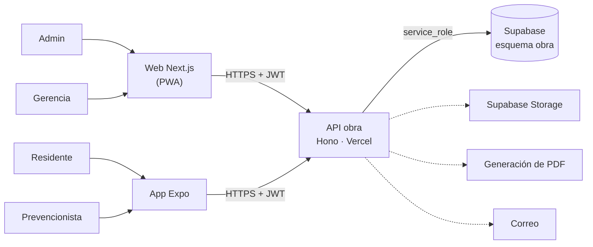

# 02 · Arquitectura — Parte diario de obra + checklist SST

Misma plataforma que todas las micro apps (ver [`GUIA-DESARROLLO.md`](../../GUIA-DESARROLLO.md) y la arquitectura de referencia en [`03-asistencia-rrhh/docs/02-arquitectura.md`](../../03-asistencia-rrhh/docs/02-arquitectura.md)).

## Componentes

| Componente | Tecnología | Despliegue |
|---|---|---|
| API | Hono + Zod + supabase-js | Vercel `parte-obra-sst-api` |
| Web | Next.js + Tailwind | Vercel `parte-obra-sst-web` |
| Móvil | Expo (React Native) | EAS Build |
| Datos | PostgreSQL, esquema `obra` | Supabase `produccion-compartida` |

## Decisiones

- Lógica de negocio en el **backend**; los clientes solo leen/escriben a través de la API.
- Se construye app **Expo**: trabajo sin conexión en obra, cámara con GPS y firma en pantalla.
- Integraciones: Supabase Storage (fotos y firmas), Generación de PDF, Correo (alertas).
