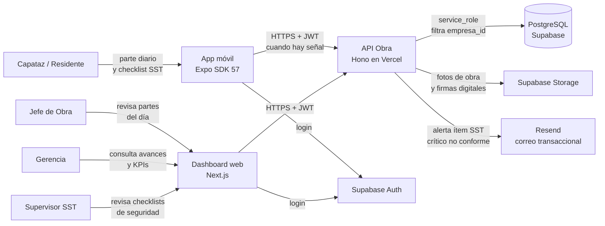
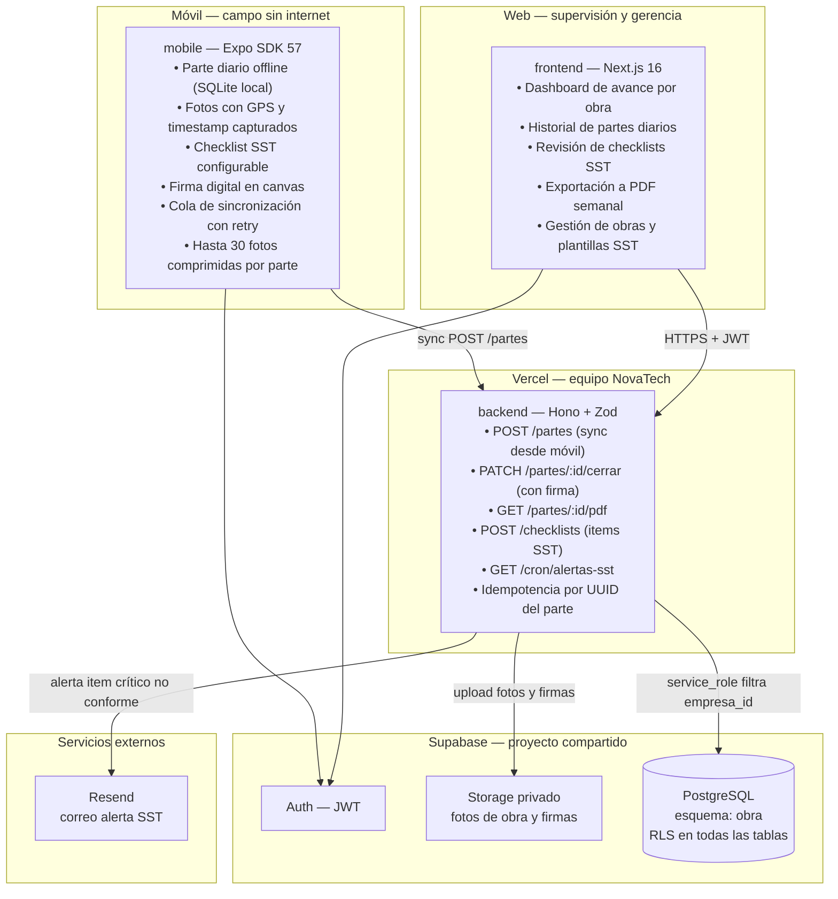
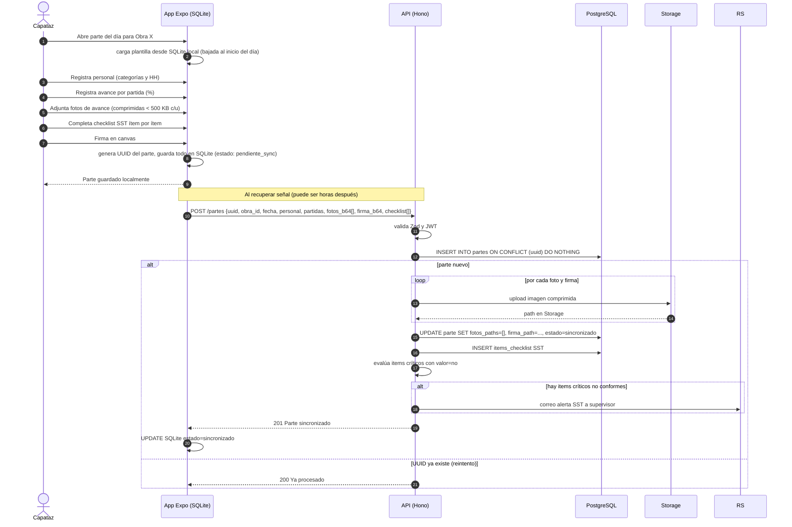
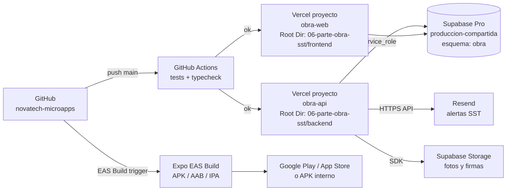

# 02 · Arquitectura — Parte Diario de Obra + Checklist SST

Los diagramas usan **Mermaid** (se ven directamente en GitHub y en VS Code con la extensión "Markdown Preview Mermaid Support").

## 1. Contexto (C1)



## 2. Contenedores (C2)



**Principio clave:** el parte diario se registra completamente offline en el dispositivo con su propio UUID; al sincronizar, la API aplica idempotencia y guarda fotos y firma en Storage antes de confirmar la sincronización al móvil, garantizando que no se pierde ninguna evidencia aunque la señal se corte a la mitad.

## 3. Secuencia principal: llenado del parte diario offline y sincronización



## 4. Diagrama de despliegue



| Componente | Proyecto Vercel | Dominio sugerido |
|---|---|---|
| API | `obra-api` (Root Dir: `06-parte-obra-sst/backend`) | `api-obra.novatechconsulting.com.pe` |
| Dashboard web | `obra-web` (Root Dir: `06-parte-obra-sst/frontend`) | `obra.novatechconsulting.com.pe` |
| Base de datos | Supabase `produccion-compartida` (esquema `obra`) | — |
| App móvil | Expo EAS · paquete `pe.com.novatechconsulting.obra` | — |

## 5. Decisiones de arquitectura (ADR)

| # | Decisión | Alternativas | Motivo |
|---|---|---|---|
| ADR-01 | **App Expo nativa** (no PWA) para campo | PWA con Service Worker | La obra puede carecer de señal hasta 24 h (RNF-09); `expo-sqlite` provee almacenamiento relacional persistente y la API de cámara permite capturar GPS y timestamp en la foto, lo que no es posible con la misma confiabilidad desde el navegador. |
| ADR-02 | **UUID generado en el dispositivo** para el parte diario | ID del servidor | El parte se crea sin conexión; el UUID permite idempotencia en la sincronización (reintento seguro si la red se corta durante el upload). |
| ADR-03 | **Fotos comprimidas en el dispositivo** antes de subir | Comprimir en el servidor | 30 fotos × 500 KB = 15 MB máximo por parte; comprimir en el móvil reduce tiempo de sincronización en señal débil de obra. Cumple RNF-08. |
| ADR-04 | **Firma digital en canvas** guardada como imagen PNG en Storage | Firma sobre PDF del parte | La imagen de firma es inmutable, más liviana que un PDF firmado, y se puede incrustar en la exportación PDF semanal desde el servidor. |
| ADR-05 | **Alertas SST por correo** (Resend), no por WhatsApp | WhatsApp para alertas SST | Los ítems críticos no conformes van al supervisor SST, que normalmente usa correo en su computadora de oficina. WhatsApp queda para el plan de contacto con clientes finales, no para comunicación interna. |
| ADR-06 | **Exportación PDF semanal generada en el servidor** | PDF en el cliente | Incluye fotos y firmas alojadas en Storage; el servidor puede acceder a ellas con `service_role` y construir el PDF completo; el cliente solo las vería con URLs firmadas temporales. |
| ADR-07 | **Checklist SST configurable por empresa** en la BD | Checklist fijo en el código | Cada empresa tiene regulaciones distintas; la configurabilidad evita actualizaciones de la app cada vez que se cambia un ítem del checklist. |

## 6. Estructura de código

```
06-parte-obra-sst/
├── backend/
│   ├── api/index.ts                   # entrada Vercel
│   ├── src/
│   │   ├── app.ts                     # Hono: CORS, auth, rutas, errores
│   │   ├── domain/
│   │   │   ├── parte.ts               # estados, regla firma obligatoria
│   │   │   ├── checklist-sst.ts       # evaluar ítems críticos no conformes
│   │   │   └── idempotencia.ts        # verificar UUID duplicado
│   │   ├── services/                  # sincronizarParte, generarPdfSemanal, alertarSST
│   │   ├── repos/                     # ParteRepo, ChecklistRepo, ObraRepo
│   │   ├── routes/
│   │   │   ├── partes.ts              # POST /partes, PATCH /cerrar, GET /pdf
│   │   │   ├── checklists.ts          # GET plantillas, POST items
│   │   │   └── obras.ts               # CRUD de obras
│   │   ├── middleware/auth.ts
│   │   └── lib/                       # supabase, storage, resend, pdf-renderer, zod
│   └── tests/
├── frontend/
│   ├── app/(panel)/
│   │   ├── obras/                     # listado y detalle por obra
│   │   ├── partes/                    # historial de partes diarios
│   │   ├── sst/                       # revisión de checklists
│   │   └── reportes/                  # exportación PDF semanal
│   ├── components/                    # GraficoAvance, TablaSST, VisorFotos, ui/
│   └── lib/                           # api-client, sesion
├── mobile/
│   ├── App.tsx
│   └── src/
│       ├── screens/                   # ParteScreen, ChecklistScreen, FirmaScreen
│       ├── db/                        # esquema SQLite local, migraciones
│       ├── sync/                      # cola upload con retry
│       └── lib/                       # camara-gps, compresion, firma-canvas
└── database/
    ├── migrations/20261008000600_obra.sql
    ├── seed.sql
    └── tests/rls_obra.test.sql
```
