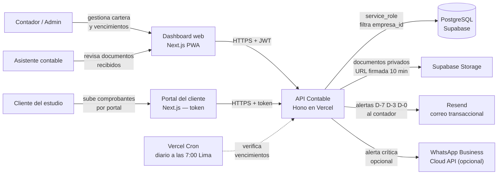
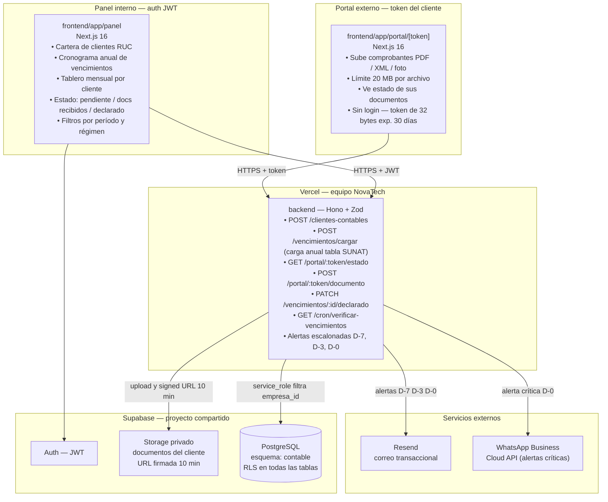
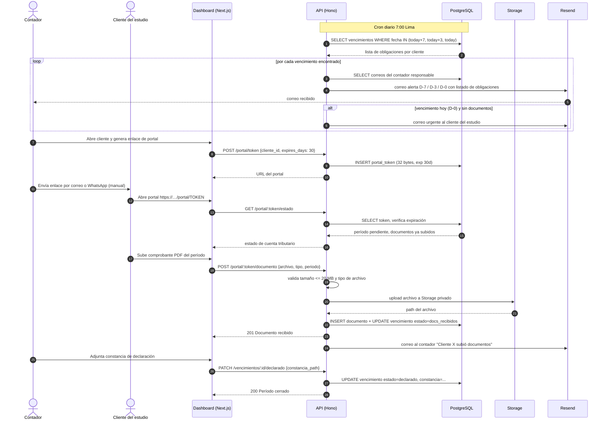
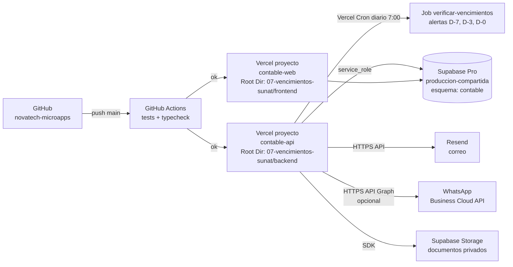

# 02 · Arquitectura — Vencimientos SUNAT + Portal de Documentos

Los diagramas usan **Mermaid** (se ven directamente en GitHub y en VS Code con la extensión "Markdown Preview Mermaid Support").

## 1. Contexto (C1)



## 2. Contenedores (C2)



**Principio clave:** la tabla de vencimientos se carga manualmente una vez al año desde el cronograma oficial publicado por SUNAT; la aplicación no calcula ni inventa fechas (RN-01), lo que garantiza que las alertas corresponden a las fechas reales de la administración tributaria.

## 3. Secuencia principal: alerta de vencimiento y recepción de documentos



## 4. Diagrama de despliegue



| Componente | Proyecto Vercel | Dominio sugerido |
|---|---|---|
| API | `contable-api` (Root Dir: `07-vencimientos-sunat/backend`) | `api-contable.novatechconsulting.com.pe` |
| Dashboard / Portal | `contable-web` (Root Dir: `07-vencimientos-sunat/frontend`) | `contable.novatechconsulting.com.pe` |
| Base de datos | Supabase `produccion-compartida` (esquema `contable`) | — |

## 5. Decisiones de arquitectura (ADR)

| # | Decisión | Alternativas | Motivo |
|---|---|---|---|
| ADR-01 | **Tabla de vencimientos cargada manualmente** desde cronograma SUNAT | Calcular fechas automáticamente según último dígito RUC | Las fechas de vencimiento dependen del cronograma oficial publicado cada año por SUNAT y pueden sufrir prórrogas; calcularlas algorítmicamente introduce riesgo de error; la carga manual garantiza exactitud. Cumple RN-01. |
| ADR-02 | **Alertas escalonadas D-7, D-3, D-0** en lugar de una sola alerta | Alerta única el día del vencimiento | Una sola alerta el día 0 llega tarde; el escalonamiento da tiempo al contador de prepararse y al cliente de subir documentos antes de la fecha límite. |
| ADR-03 | **Portal del cliente sin contraseña** con token de 32 bytes | Cuenta de usuario con contraseña | El cliente del estudio no accede diariamente; un token enviado por correo elimina la fricción de contraseña y recuperaciones de cuenta. El token expira a 30 días. Cumple RNF-08. |
| ADR-04 | **Documentos en Storage privado** con URL firmada de 10 minutos | Storage público o en BD | Los documentos tributarios son confidenciales; las URLs firmadas limitan el acceso temporal sin exponer rutas permanentes. Cumple RNF-08. |
| ADR-05 | **Correo como canal principal** (Resend), WhatsApp solo para alertas críticas D-0 | Solo WhatsApp o solo correo | El contador trabaja en su computadora y prefiere correo para acción; WhatsApp queda para el D-0 como llamada de atención urgente de bajo costo adicional. Cumple R9. |
| ADR-06 | **Estado "declarado" solo con constancia adjunta** | Solo con click del contador | Cumple RN-02: evita marcar períodos como declarados sin evidencia adjunta, lo que protege al estudio ante auditorías. |
| ADR-07 | **Un esquema por app** (`contable`) en Supabase compartido | Proyecto Supabase separado | Costo ~US$10/mes por proyecto adicional; el esquema con RLS aísla los datos de cada estudio contable. Cumple R7. |

## 6. Estructura de código

```
07-vencimientos-sunat/
├── backend/
│   ├── api/index.ts                   # entrada Vercel
│   ├── src/
│   │   ├── app.ts                     # Hono: CORS, auth, rutas, errores
│   │   ├── domain/
│   │   │   ├── vencimiento.ts         # estados, regla constancia obligatoria
│   │   │   ├── alerta.ts              # lógica D-7, D-3, D-0
│   │   │   └── ruc.ts                 # validación dígito verificador
│   │   ├── services/                  # verificarVencimientos, procesarDocumento
│   │   ├── repos/                     # VencimientoRepo, DocumentoRepo, ClienteRepo
│   │   ├── routes/
│   │   │   ├── clientes-contables.ts  # CRUD cartera
│   │   │   ├── vencimientos.ts        # carga anual, PATCH declarado
│   │   │   ├── portal.ts              # GET|POST /portal/:token/...
│   │   │   └── cron.ts                # GET /cron/verificar-vencimientos
│   │   ├── middleware/auth.ts
│   │   └── lib/                       # supabase, storage, resend, whatsapp, zod
│   └── tests/
├── frontend/
│   ├── app/
│   │   ├── portal/[token]/            # portal público del cliente
│   │   └── (panel)/
│   │       ├── clientes/              # cartera de empresas
│   │       ├── calendario/            # cronograma de vencimientos
│   │       ├── documentos/            # revisión de archivos recibidos
│   │       └── reportes/              # estado mensual por cliente
│   ├── components/                    # CalendarioVencimientos, TablaEstado, ui/
│   └── lib/                           # api-client, sesion, formato-fecha
└── database/
    ├── migrations/20261008000700_contable.sql
    ├── seed.sql
    └── tests/rls_contable.test.sql
```
