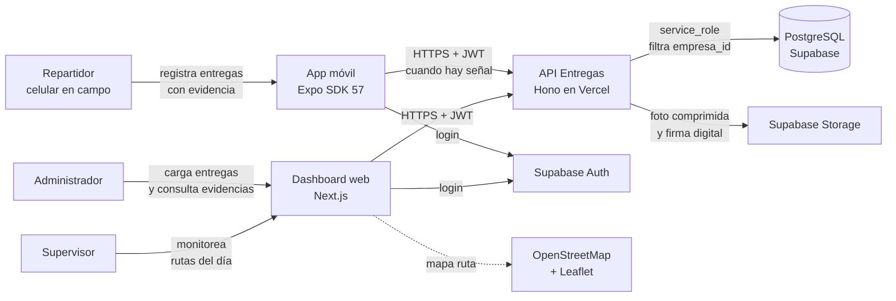
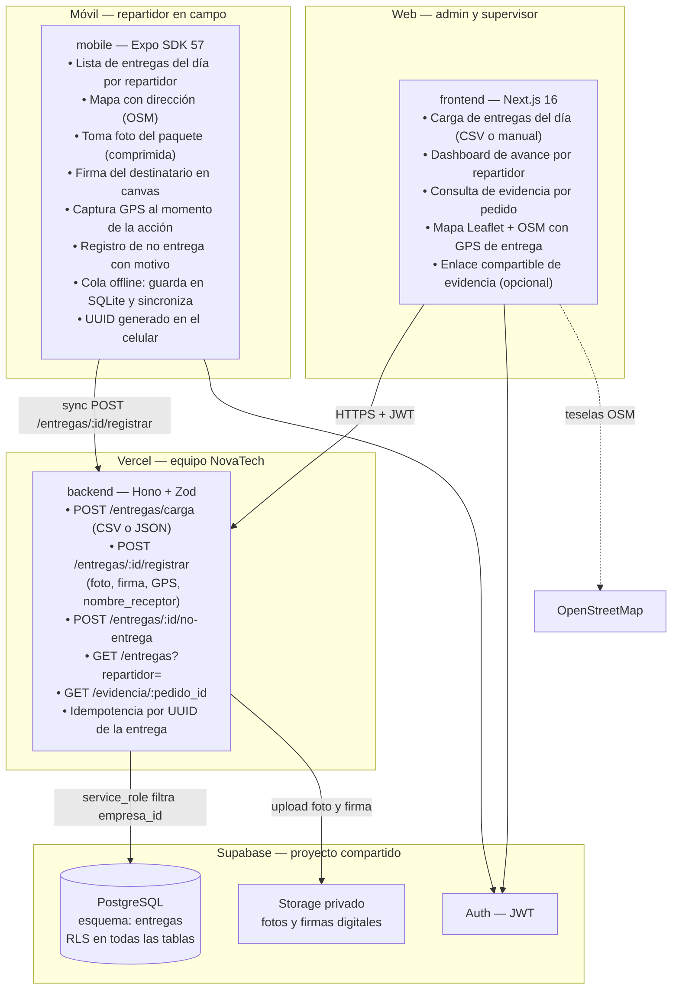
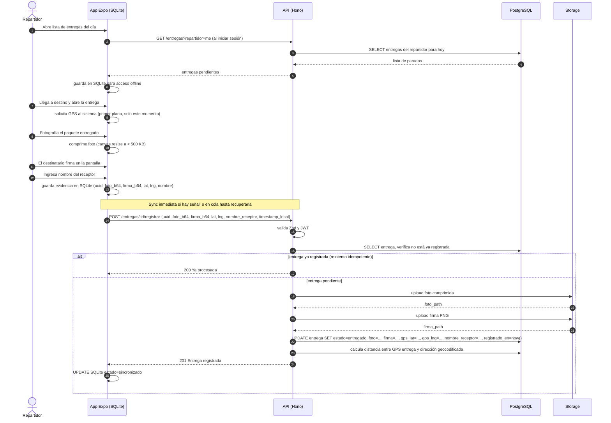
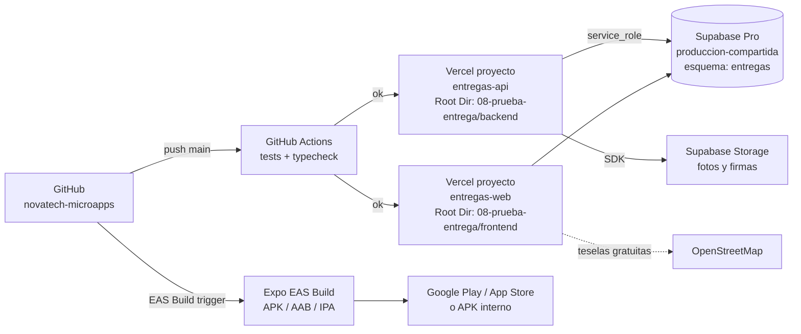

# 02 · Arquitectura — Prueba de Entrega (Foto, Firma, GPS)

Los diagramas usan **Mermaid** (se ven directamente en GitHub y en VS Code con la extensión "Markdown Preview Mermaid Support").

## 1. Contexto (C1)



## 2. Contenedores (C2)



**Principio clave:** la evidencia (foto + firma + GPS + timestamp del servidor) es inmutable una vez sincronizada (RN-01); la API rechaza cualquier intento de actualizar una entrega ya registrada, y el GPS se captura únicamente en el momento de la acción, no en segundo plano (R8).

## 3. Secuencia principal: registro de entrega con evidencia



## 4. Diagrama de despliegue



| Componente | Proyecto Vercel | Dominio sugerido |
|---|---|---|
| API | `entregas-api` (Root Dir: `08-prueba-entrega/backend`) | `api-entregas.novatechconsulting.com.pe` |
| Dashboard web | `entregas-web` (Root Dir: `08-prueba-entrega/frontend`) | `entregas.novatechconsulting.com.pe` |
| Base de datos | Supabase `produccion-compartida` (esquema `entregas`) | — |
| App móvil | Expo EAS · paquete `pe.com.novatechconsulting.entregas` | — |

## 5. Decisiones de arquitectura (ADR)

| # | Decisión | Alternativas | Motivo |
|---|---|---|---|
| ADR-01 | **App Expo nativa** (no PWA) para el repartidor | PWA con cámara del navegador | La app nativa con `expo-camera` y `expo-location` ofrece acceso más confiable a cámara, GPS de alta precisión y modo offline con `expo-sqlite`; crítico para hasta 300 entregas/día en campo con señal intermitente (RNF-08). |
| ADR-02 | **Evidencia inmutable** una vez sincronizada | Permitir correcciones | La evidencia es prueba legal ante reclamos de "no me llegó"; la inmutabilidad protege al cliente de ediciones posteriores. La API rechaza PATCHs sobre entregas ya registradas. Cumple RN-01. |
| ADR-03 | **GPS capturado solo al momento de la entrega** (primer plano) | GPS en segundo plano continuo | Batería, privacidad (Ley 29733) y aprobación en tiendas de aplicaciones. Cumple R8. |
| ADR-04 | **Foto comprimida en el dispositivo** antes de subir (< 500 KB) | Comprimir en el servidor | 300 entregas × foto + firma en un día implica alto volumen; comprimir en el móvil reduce el uso de datos y el tiempo de sync en 4G limitado. |
| ADR-05 | **Mapa con OpenStreetMap + Leaflet** en el dashboard | Google Maps | Sin costo ni API key; cumple R10. El volumen de mapa del dashboard (vista por repartidor) no requiere funciones avanzadas de Google Maps. |
| ADR-06 | **UUID generado en el celular** para idempotencia | ID del servidor generado en el primer POST | El repartidor puede reintentar la sync si la señal se corta durante el upload; el UUID garantiza que la entrega no se registre dos veces aunque el servidor reciba el POST más de una vez. |
| ADR-07 | **Distancia entre GPS de entrega y dirección geocodificada** guardada en la BD | No guardar la distancia | Permite auditoría posterior de entregas que se registraron lejos del domicilio, sin exponer un sistema de alerta que el repartidor pueda evadir; referencia para reclamos. Cumple RN-02. |

## 6. Estructura de código

```
08-prueba-entrega/
├── backend/
│   ├── api/index.ts                   # entrada Vercel
│   ├── src/
│   │   ├── app.ts                     # Hono: CORS, auth, rutas, errores
│   │   ├── domain/
│   │   │   ├── entrega.ts             # estados, regla inmutabilidad
│   │   │   ├── gps.ts                 # cálculo distancia Haversine
│   │   │   └── evidencia.ts           # validar campos obligatorios (foto+firma+gps+nombre)
│   │   ├── services/                  # registrarEntrega, registrarNoEntrega, cargaCSV
│   │   ├── repos/                     # EntregaRepo, RepartidorRepo
│   │   ├── routes/
│   │   │   ├── entregas.ts            # GET listado, POST carga, PATCH registrar
│   │   │   ├── no-entrega.ts          # POST /entregas/:id/no-entrega
│   │   │   └── evidencia.ts           # GET /evidencia/:pedido_id (enlace compartible)
│   │   ├── middleware/auth.ts
│   │   └── lib/                       # supabase, storage, zod-schemas
│   └── tests/
├── frontend/
│   ├── app/(panel)/
│   │   ├── dashboard/                 # avance por repartidor y resumen del día
│   │   ├── entregas/                  # carga CSV y listado
│   │   ├── evidencia/[pedido]/        # consulta con foto, firma y mapa
│   │   └── repartidores/
│   ├── components/                    # MapaEntregas (Leaflet), TablaEntregas, ui/
│   └── lib/                           # api-client, sesion
├── mobile/
│   ├── App.tsx
│   └── src/
│       ├── screens/
│       │   ├── ListaEntregasScreen.tsx
│       │   ├── RegistrarEntregaScreen.tsx  # foto + firma + GPS
│       │   └── NoEntregaScreen.tsx
│       ├── db/                         # SQLite: entregas pendientes y cola sync
│       ├── sync/                       # cola con retry y manejo de conflictos
│       └── lib/                        # camara, firma-canvas, gps, compresion
└── database/
    ├── migrations/20261008000800_entregas.sql
    ├── seed.sql
    └── tests/rls_entregas.test.sql
```
