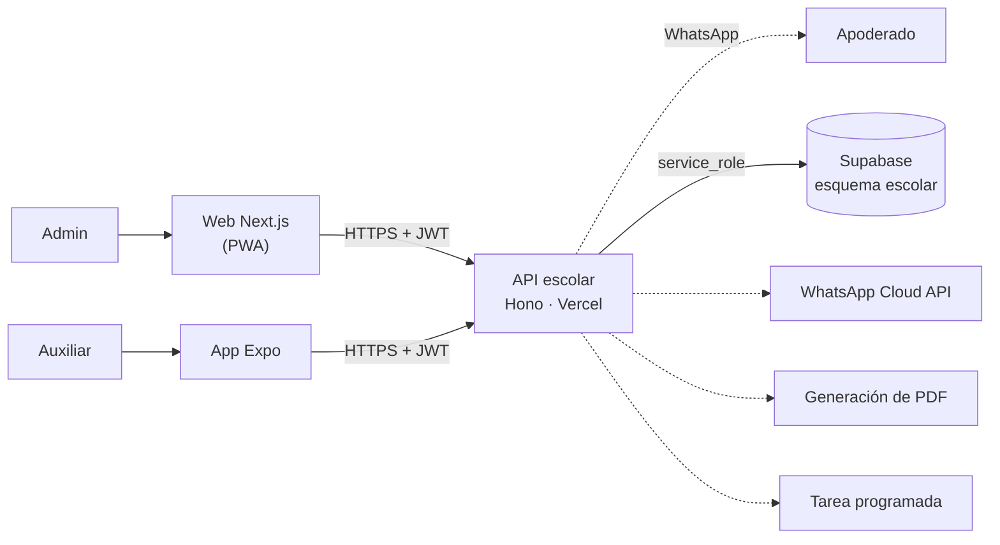

# 02 · Arquitectura — Asistencia por QR con aviso a padres

Misma plataforma que todas las micro apps (ver [`GUIA-DESARROLLO.md`](../../GUIA-DESARROLLO.md) y la arquitectura de referencia en [`03-asistencia-rrhh/docs/02-arquitectura.md`](../../03-asistencia-rrhh/docs/02-arquitectura.md)).

## Componentes

| Componente | Tecnología | Despliegue |
|---|---|---|
| API | Hono + Zod + supabase-js | Vercel `asistencia-escolar-qr-api` |
| Web | Next.js + Tailwind | Vercel `asistencia-escolar-qr-web` |
| Móvil | Expo (React Native) | EAS Build |
| Datos | PostgreSQL, esquema `escolar` | Supabase `produccion-compartida` |

## Decisiones

- Lógica de negocio en el **backend**; los clientes solo leen/escriben a través de la API.
- Se recomienda **Expo** (reutiliza la app 03) para un escáner QR rápido con `expo-camera` y cola sin conexión. Alternativa PWA si el colegio usa una sola tablet con buena señal.
- Integraciones: WhatsApp Cloud API, Generación de PDF, Tarea programada.
