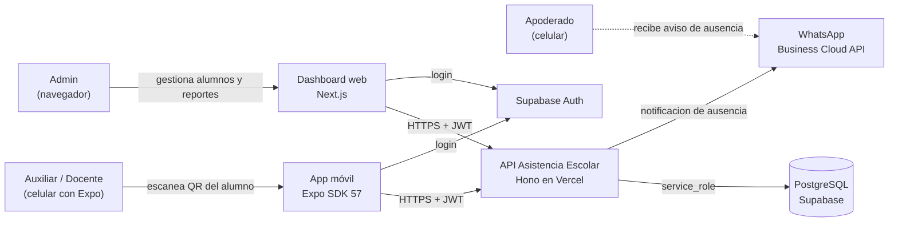
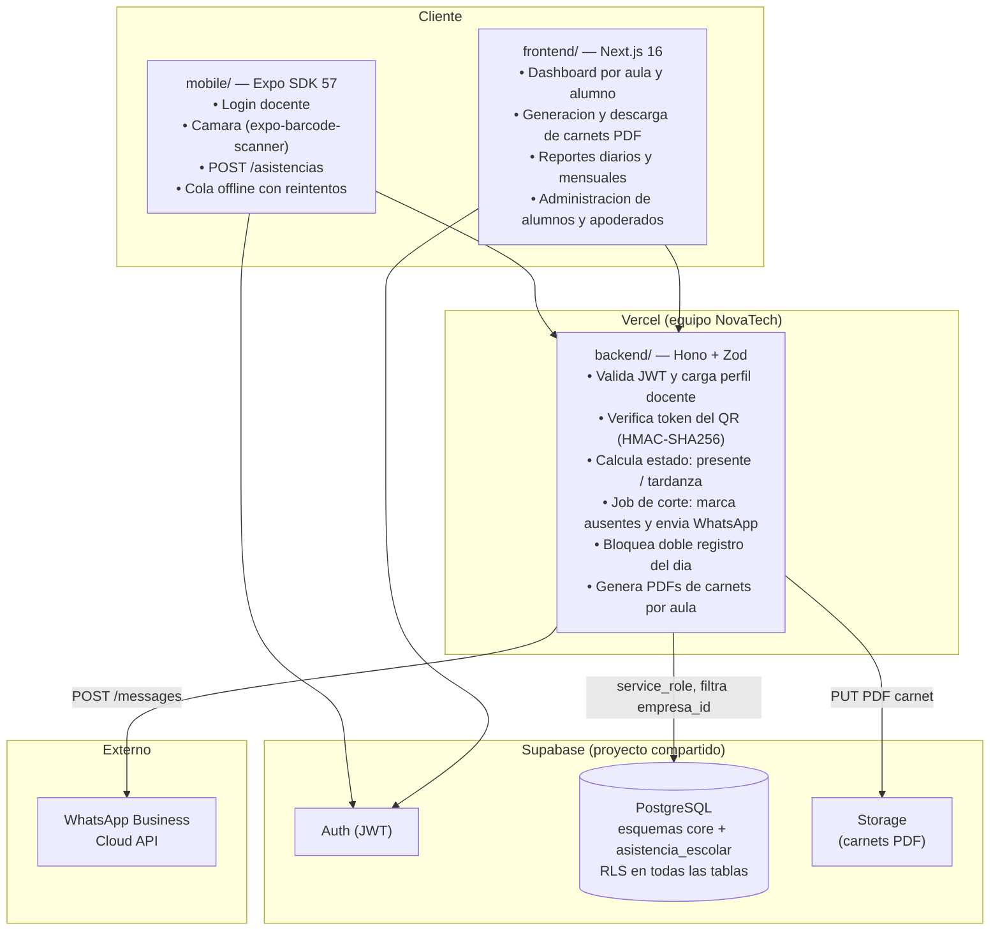
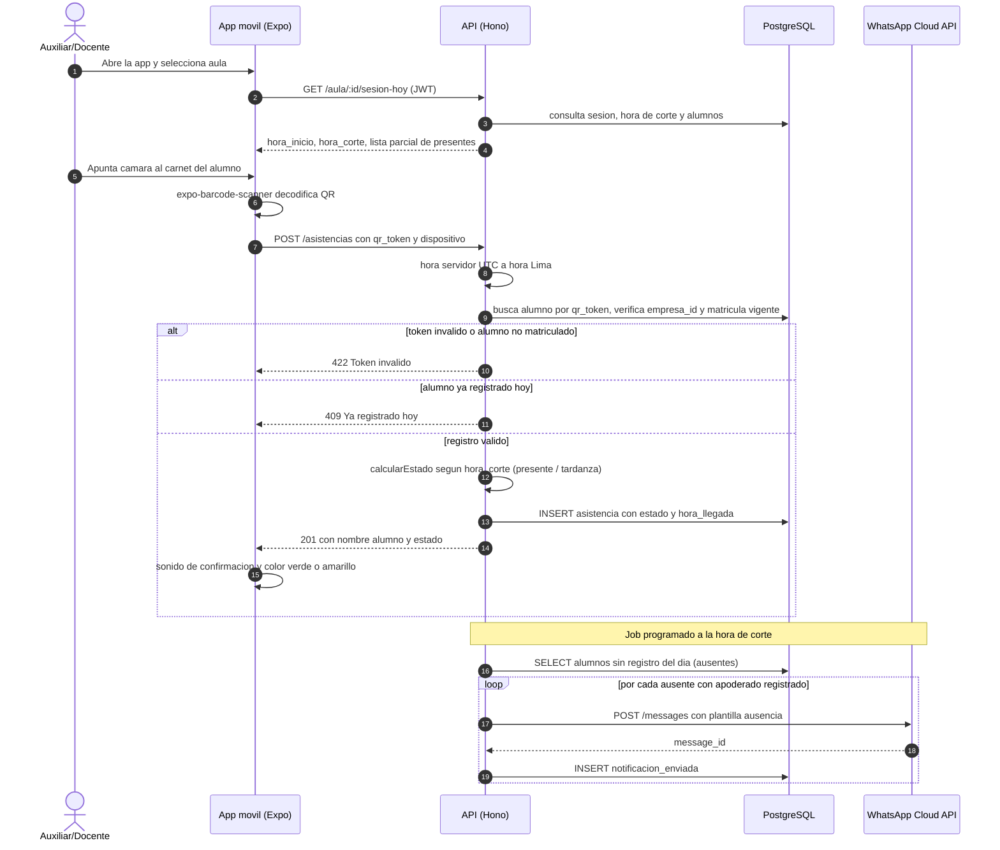
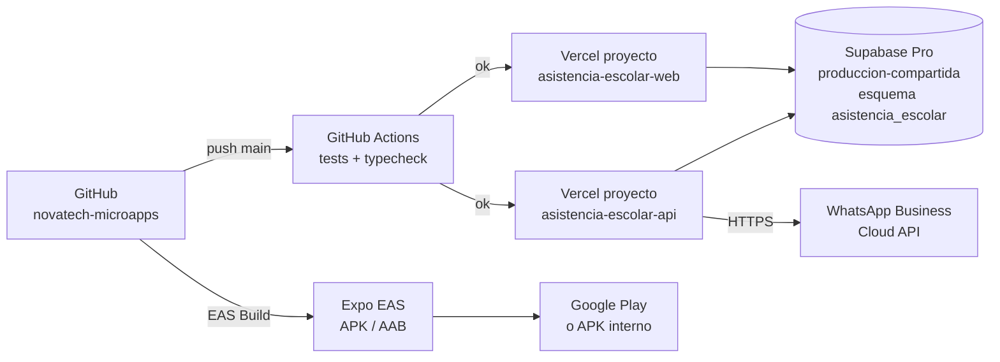

# 02 · Arquitectura — Asistencia Escolar por QR con Aviso a Padres

Los diagramas usan **Mermaid** (se ven directamente en GitHub y en VS Code con la extensión "Markdown Preview Mermaid Support").

## 1. Contexto (C1)



## 2. Contenedores (C2)



**Principio clave:** el servidor es la unica fuente de verdad sobre el estado de asistencia. El dispositivo del docente unicamente captura el QR y lo envia; **nunca decide** si el alumno esta presente, tardio o ausente, ni envia el aviso a los padres directamente.

## 3. Secuencia principal: escaneo de QR y registro de asistencia



## 4. Diagrama de despliegue



| Componente | Proyecto Vercel | Dominio sugerido |
|---|---|---|
| API | `asistencia-escolar-api` (Root: `09-asistencia-escolar-qr/backend`) | `api-asistencia-escolar.novatechconsulting.com.pe` |
| Dashboard web | `asistencia-escolar-web` (Root: `09-asistencia-escolar-qr/frontend`) | `asistencia-escolar.novatechconsulting.com.pe` |
| Base de datos | Supabase `produccion-compartida` (esquema `asistencia_escolar`) | — |
| App movil | Expo EAS · paquete `pe.com.novatechconsulting.asistenciaescolar` | — |

## 5. Decisiones de arquitectura (ADR)

| # | Decision | Alternativas | Motivo |
|---|---|---|---|
| ADR-01 | **Token HMAC-SHA256 en el QR**, no el ID del alumno en claro | UUID directo, DNI | Un ID en el QR es falsificable; HMAC con secret del backend impide fabricar QRs validos o enumerar alumnos. |
| ADR-02 | **Aviso WhatsApp desde el servidor** via job a la hora de corte | Envio inmediato al escanear, SMS, correo | La ausencia solo se confirma al vencer la hora de corte; enviar antes genera falsas alarmas si el alumno llega tarde dentro del margen. |
| ADR-03 | **App nativa Expo** para el docente (no PWA) | PWA con WebRTC | `expo-barcode-scanner` ofrece acceso a la camara nativa con latencia menor a 300 ms y funciona offline con cola de reintentos; la WebRTC en movil es menos fiable para uso intensivo en la puerta. |
| ADR-04 | **PDF de carnets generado en el servidor** (backend + PDFKit) | Generado en navegador con jsPDF | El servidor controla la plantilla y garantiza el HMAC del token sin exponerlo al cliente. |
| ADR-05 | **Un solo registro por alumno por dia** con indice unico `(empresa_id, alumno_id, fecha_local)` | Permitir multiples y tomar el primero | La restriccion en base de datos elimina race conditions si el docente escanea dos veces por error. |
| ADR-06 | **Supabase proyecto compartido** con esquema `asistencia_escolar` | Proyecto dedicado por cliente | Cada proyecto adicional cuesta aproximadamente USD 10 al mes; RLS mas filtro `empresa_id` en el backend proveen aislamiento suficiente para datos escolares. |
| ADR-07 | **Sin fotos de alumnos** en el QR ni en la base de datos | Foto en ficha del alumno | Datos de menores (RNF-09, Ley 29733); principio de minimizacion del dato. |

## 6. Estructura de codigo

```
09-asistencia-escolar-qr/
├── backend/
│   ├── api/index.ts                   # entrada Vercel (serverless)
│   ├── src/
│   │   ├── app.ts                     # Hono: CORS, auth, rutas, errores globales
│   │   ├── domain/
│   │   │   ├── qr.ts                  # generarToken, verificarToken (HMAC-SHA256)
│   │   │   ├── asistencia.ts          # calcularEstado (presente/tardanza), esAusente
│   │   │   └── notificacion.ts        # construirMensajeWhatsApp
│   │   ├── services/
│   │   │   ├── registrarAsistencia.ts # caso de uso principal
│   │   │   ├── procesarAusencias.ts   # job hora de corte
│   │   │   └── generarCarnetsPDF.ts
│   │   ├── repos/
│   │   │   ├── AsistenciaRepo.ts
│   │   │   ├── AlumnoRepo.ts
│   │   │   └── NotificacionRepo.ts
│   │   ├── routes/
│   │   │   ├── asistencias.ts         # POST /asistencias, GET /aula/:id/sesion-hoy
│   │   │   ├── carnets.ts             # GET /aulas/:id/carnets.pdf
│   │   │   ├── reportes.ts            # diario y mensual
│   │   │   └── admin.ts               # CRUD alumnos, aulas, apoderados
│   │   ├── middleware/
│   │   │   └── auth.ts                # JWT a perfil (empresa, rol)
│   │   └── lib/
│   │       ├── supabase.ts
│   │       ├── whatsapp.ts
│   │       ├── pdf.ts
│   │       └── errors.ts
│   └── tests/                         # Vitest + pgTAP RLS
├── frontend/
│   ├── app/
│   │   ├── login/
│   │   └── (panel)/
│   │       ├── dashboard/             # resumen del dia por aula
│   │       ├── alumnos/               # CRUD + descarga QR individual
│   │       ├── aulas/
│   │       └── reportes/
│   ├── components/
│   │   ├── QRCard.tsx
│   │   └── EstadoBadge.tsx
│   └── lib/
│       ├── api.ts
│       └── formato.ts                 # hora Lima, fechas
├── mobile/
│   ├── App.tsx
│   └── src/
│       ├── screens/
│       │   ├── LoginScreen.tsx
│       │   ├── ScanScreen.tsx         # expo-barcode-scanner + cola offline
│       │   └── ResumenScreen.tsx
│       ├── hooks/
│       │   ├── useScanner.ts
│       │   └── useColaOffline.ts      # AsyncStorage + retry
│       └── lib/
│           ├── api.ts
│           └── audio.ts
└── database/
    ├── migrations/20261028000900_asistencia_escolar.sql
    ├── seed.sql
    └── tests/rls_asistencia_escolar.test.sql
```
