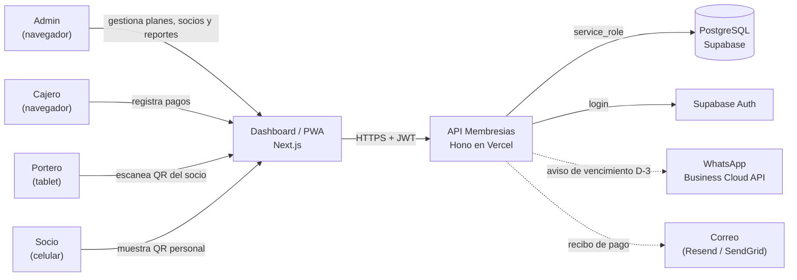
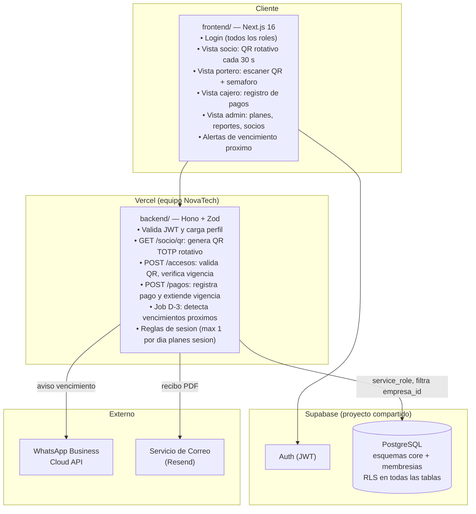
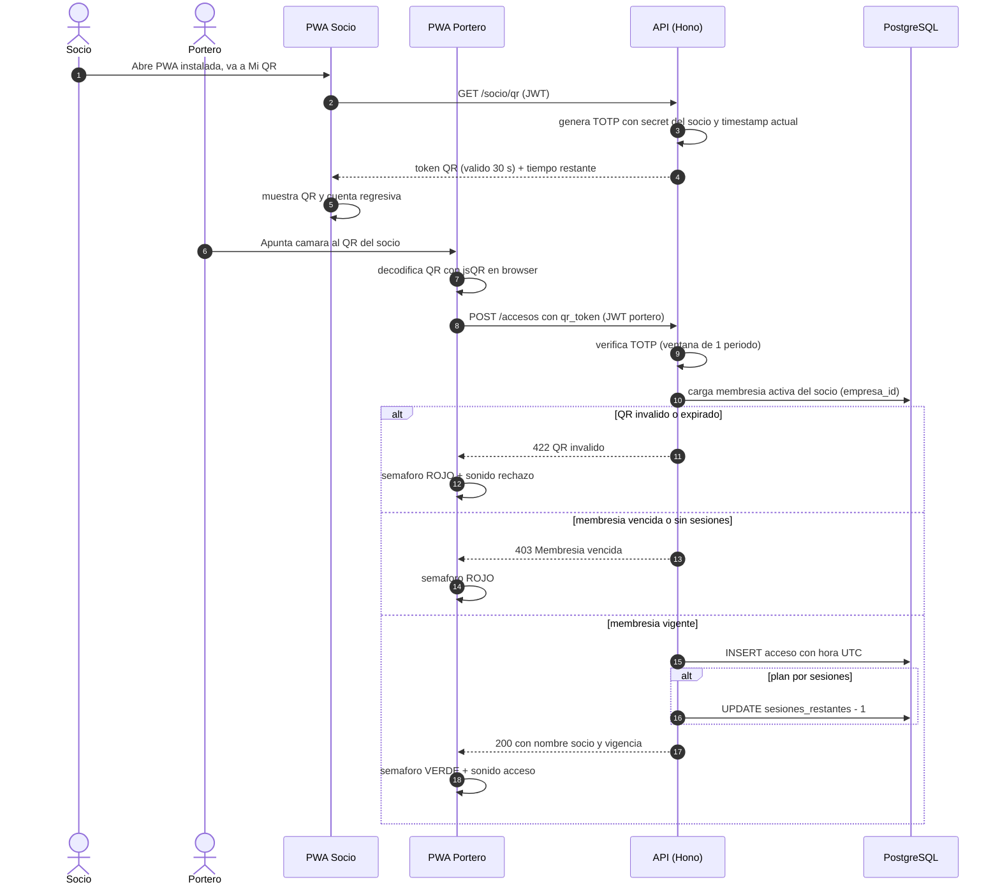
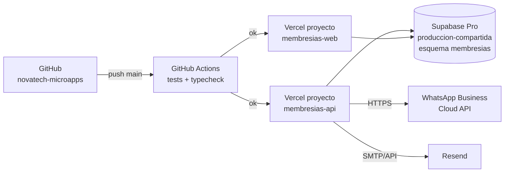

# 02 · Arquitectura — Membresias con Acceso por QR

Los diagramas usan **Mermaid** (se ven directamente en GitHub y en VS Code con la extension "Markdown Preview Mermaid Support").

## 1. Contexto (C1)



## 2. Contenedores (C2)



**Principio clave:** el QR del socio es **rotativo cada 30 segundos** (TOTP/HMAC con timestamp) para impedir capturas de pantalla reutilizables. La validacion de vigencia ocurre exclusivamente en el servidor; el cliente portero nunca toma la decision de abrir o cerrar.

## 3. Secuencia principal: ingreso del socio al gimnasio



## 4. Diagrama de despliegue



| Componente | Proyecto Vercel | Dominio sugerido |
|---|---|---|
| API | `membresias-api` (Root: `10-membresias-gimnasio/backend`) | `api-membresias.novatechconsulting.com.pe` |
| Web / PWA | `membresias-web` (Root: `10-membresias-gimnasio/frontend`) | `membresias.novatechconsulting.com.pe` |
| Base de datos | Supabase `produccion-compartida` (esquema `membresias`) | — |

## 5. Decisiones de arquitectura (ADR)

| # | Decision | Alternativas | Motivo |
|---|---|---|---|
| ADR-01 | **QR rotativo TOTP cada 30 s** firmado con secret por socio | QR estatico con UUID | Un QR estatico puede fotografiarse y compartirse; el TOTP invalida capturas pasadas los 30 s sin necesidad de base de datos por cada validacion. |
| ADR-02 | **PWA para todos los roles** (portero, socio, cajero) | App nativa Expo | El portero usa tablet con buena conexion; jsQR en WebRTC es suficiente para esta cadencia de escaneo (< 100 ingresos/hora). Evita mantenimiento de dos plataformas. |
| ADR-03 | **Validacion de vigencia 100% en el servidor** | Logica en el cliente portero | El cliente es manipulable; un socio con acceso al devtools podria falsear el resultado en el frontend. |
| ADR-04 | **Job D-3 para avisos de vencimiento** (Vercel Cron o pg_cron) | Verificar en cada ingreso | Desacopla el flujo critico de acceso del envio de mensajes; evita latencia adicional en la validacion del QR. |
| ADR-05 | **Vigencia calculada al registrar el pago** (extiende desde fin actual si vigente, desde hoy si vencido) | Calcular en el momento de lectura | Un valor precalculado es mas simple de consultar, indexar y auditar. |
| ADR-06 | **Indice unico de acceso por dia para planes por sesion** `(empresa_id, socio_id, fecha_local)` | Contar accesos al momento | Previene descuentos multiples por doble escaneo sin necesidad de logica optimista. |
| ADR-07 | **WhatsApp solo para aviso de vencimiento** (no para confirmacion de acceso) | Mensaje en cada ingreso | El aviso de acceso seria spam; R9 del stack establece WhatsApp solo para alertas relevantes. |

## 6. Estructura de codigo

```
10-membresias-gimnasio/
├── backend/
│   ├── api/index.ts                   # entrada Vercel
│   ├── src/
│   │   ├── app.ts                     # Hono: CORS, auth, rutas
│   │   ├── domain/
│   │   │   ├── qr.ts                  # generarTOTP, verificarTOTP
│   │   │   ├── membresia.ts           # calcularVigencia, estaVigente, sesionesRestantes
│   │   │   └── pago.ts                # extenderVigencia
│   │   ├── services/
│   │   │   ├── validarAcceso.ts       # caso de uso portero
│   │   │   ├── registrarPago.ts       # caso de uso cajero
│   │   │   └── procesarVencimientos.ts # job D-3
│   │   ├── repos/
│   │   │   ├── SocioRepo.ts
│   │   │   ├── MembresiaRepo.ts
│   │   │   └── AccesoRepo.ts
│   │   ├── routes/
│   │   │   ├── socio.ts               # GET /socio/qr
│   │   │   ├── accesos.ts             # POST /accesos
│   │   │   ├── pagos.ts               # POST /pagos
│   │   │   ├── reportes.ts
│   │   │   └── admin.ts               # CRUD planes, socios
│   │   ├── middleware/auth.ts
│   │   └── lib/
│   │       ├── supabase.ts
│   │       ├── whatsapp.ts
│   │       ├── correo.ts
│   │       └── errors.ts
│   └── tests/
├── frontend/
│   ├── app/
│   │   ├── login/
│   │   └── (panel)/
│   │       ├── mi-qr/                 # vista socio: QR rotativo
│   │       ├── porteria/              # vista portero: escaner
│   │       ├── pagos/                 # vista cajero
│   │       ├── socios/
│   │       ├── planes/
│   │       └── reportes/
│   ├── components/
│   │   ├── QRRotativo.tsx             # refresca cada 30 s
│   │   ├── Semaforo.tsx               # verde / rojo con animacion
│   │   └── ui/
│   └── lib/
│       ├── api.ts
│       ├── qrScanner.ts               # jsQR wrapper
│       └── formato.ts
└── database/
    ├── migrations/20261028001000_membresias.sql
    ├── seed.sql
    └── tests/rls_membresias.test.sql
```
