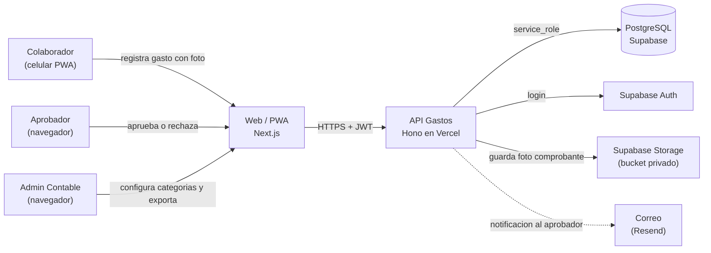
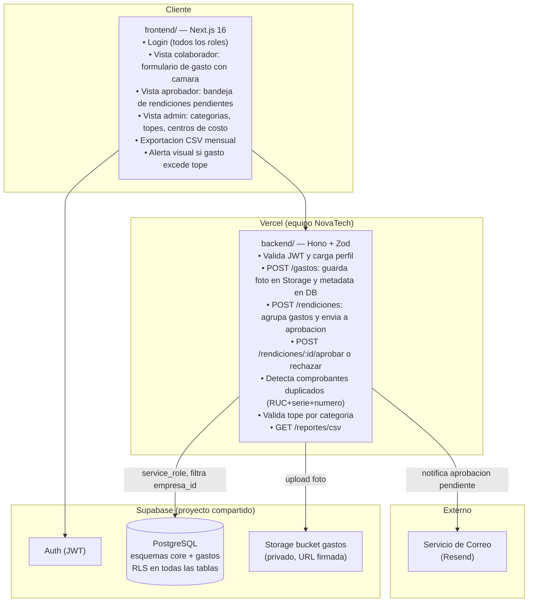
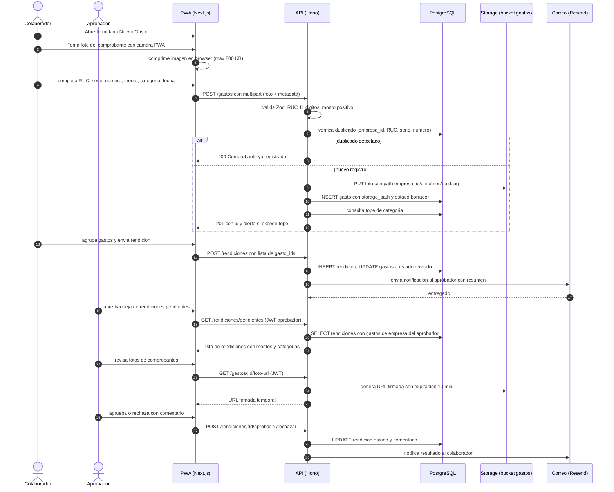
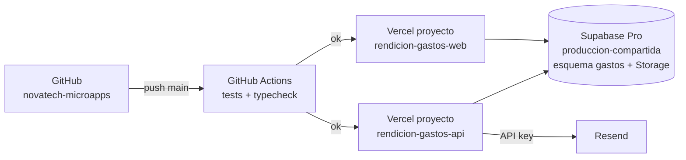

# 02 · Arquitectura — Rendicion de Gastos con Foto de Comprobante

Los diagramas usan **Mermaid** (se ven directamente en GitHub y en VS Code con la extension "Markdown Preview Mermaid Support").

## 1. Contexto (C1)



## 2. Contenedores (C2)



**Principio clave:** las fotos de comprobantes se guardan en un **bucket privado de Supabase Storage**; el cliente nunca recibe una URL publica permanente, sino **URL firmadas de corta duracion** generadas por el backend bajo demanda, respetando el RLS de datos.

## 3. Secuencia principal: registro de gasto y flujo de aprobacion



## 4. Diagrama de despliegue



| Componente | Proyecto Vercel | Dominio sugerido |
|---|---|---|
| API | `rendicion-gastos-api` (Root: `11-rendicion-gastos/backend`) | `api-gastos.novatechconsulting.com.pe` |
| Web / PWA | `rendicion-gastos-web` (Root: `11-rendicion-gastos/frontend`) | `gastos.novatechconsulting.com.pe` |
| Base de datos | Supabase `produccion-compartida` (esquema `gastos`) | — |
| Storage | Supabase `produccion-compartida` bucket `gastos` (privado) | — |

## 5. Decisiones de arquitectura (ADR)

| # | Decision | Alternativas | Motivo |
|---|---|---|---|
| ADR-01 | **Fotos en bucket privado con URL firmada** (10 min) | Bucket publico con URL permanente, Google Drive | Datos financieros y fiscales deben tener acceso controlado; la URL firmada expira automaticamente y fuerza validacion de sesion en cada acceso. |
| ADR-02 | **Compresion de imagen en el browser** antes de subir | Subir en full resolution, comprimir en servidor | Reduce el consumo de ancho de banda del cliente movil y el tiempo de carga; la calidad resultante (max 800 KB) es suficiente para leer RUC y montos. |
| ADR-03 | **Deteccion de duplicado por (empresa_id, RUC, serie, numero)** a nivel DB con constraint unico | Solo validacion en codigo | La restriccion en base de datos es la barrera mas robusta; elimina race conditions en envios concurrentes. |
| ADR-04 | **Estado de rendicion inmutable tras aprobacion** (RN-01) | Edicion con trazabilidad | Simplifica la auditoria contable; cualquier correccion requiere nueva rendicion, lo que genera trazabilidad automatica. |
| ADR-05 | **El aprobador no puede aprobar sus propios gastos** (RN-02) validado en el servidor | Solo en el frontend | La regla de negocio en el servidor evita que un cambio de rol o una llamada directa a la API omita la restriccion. |
| ADR-06 | **Exportacion CSV generada en el servidor** con streaming | Descarga desde el cliente con datos cacheados | El volumen mensual puede ser grande; el servidor filtra por empresa_id, periodo y centro de costo sin exponer datos de otras empresas. |
| ADR-07 | **Notificaciones solo por correo** (no WhatsApp) | WhatsApp, push nativa | El flujo de aprobacion es un proceso laboral interno; el correo es el canal adecuado y no genera costo variable por mensaje. |

## 6. Estructura de codigo

```
11-rendicion-gastos/
├── backend/
│   ├── api/index.ts
│   ├── src/
│   │   ├── app.ts
│   │   ├── domain/
│   │   │   ├── gasto.ts               # validarDuplicado, calcularExcedente
│   │   │   ├── rendicion.ts           # calcularTotal, estadoPermitido
│   │   │   └── storage.ts             # generarPath, generarURLFirmada
│   │   ├── services/
│   │   │   ├── registrarGasto.ts      # sube foto y guarda metadata
│   │   │   ├── enviarRendicion.ts
│   │   │   └── aprobarRechazar.ts
│   │   ├── repos/
│   │   │   ├── GastoRepo.ts
│   │   │   └── RendicionRepo.ts
│   │   ├── routes/
│   │   │   ├── gastos.ts              # POST /gastos, GET /gastos/:id/foto-url
│   │   │   ├── rendiciones.ts         # POST, GET pendientes, aprobar, rechazar
│   │   │   ├── reportes.ts            # GET /reportes/csv
│   │   │   └── admin.ts               # CRUD categorias, topes, centros de costo
│   │   ├── middleware/auth.ts
│   │   └── lib/
│   │       ├── supabase.ts
│   │       ├── storage.ts
│   │       ├── correo.ts
│   │       └── csv.ts
│   └── tests/
├── frontend/
│   ├── app/
│   │   ├── login/
│   │   └── (panel)/
│   │       ├── nuevo-gasto/           # formulario con camara PWA
│   │       ├── mis-rendiciones/
│   │       ├── aprobar/               # bandeja del aprobador
│   │       ├── reportes/
│   │       └── admin/                 # categorias y topes
│   ├── components/
│   │   ├── CamaraComprobante.tsx      # PWA camera API
│   │   ├── EstadoBadge.tsx
│   │   └── ui/
│   └── lib/
│       ├── api.ts
│       ├── imagen.ts                  # compresion browser-side
│       └── formato.ts
└── database/
    ├── migrations/20261028001100_gastos.sql
    ├── seed.sql
    └── tests/rls_gastos.test.sql
```
