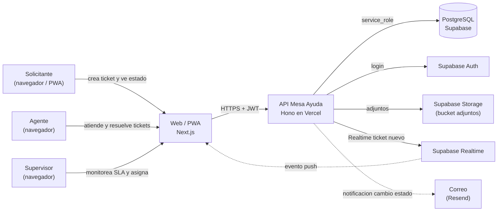
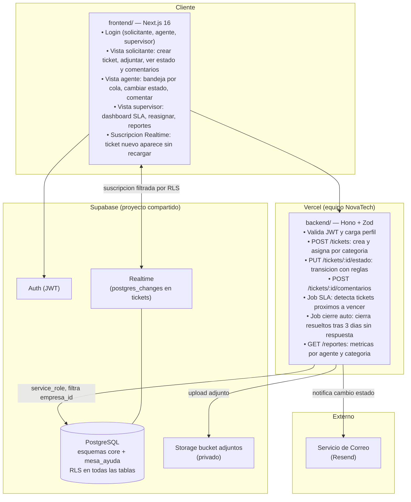
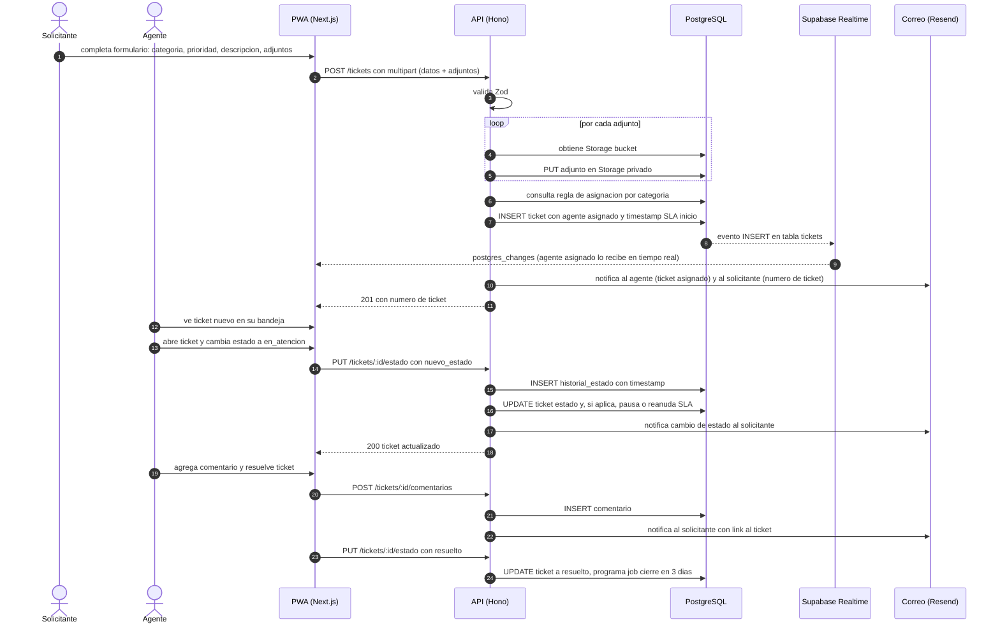
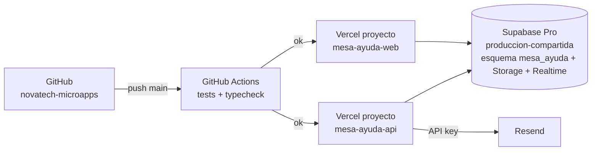

# 02 · Arquitectura — Mesa de Ayuda Interna (Tickets)

Los diagramas usan **Mermaid** (se ven directamente en GitHub y en VS Code con la extension "Markdown Preview Mermaid Support").

## 1. Contexto (C1)



## 2. Contenedores (C2)



**Principio clave:** **Supabase Realtime** notifica al agente en tiempo real cuando llega un ticket nuevo a su cola, sin sondeo. El SLA se pausa automaticamente cuando el ticket pasa a estado "en_espera" y se reanuda al volver a "en_atencion"; este calculo ocurre en el servidor, nunca en el cliente.

## 3. Secuencia principal: creacion de ticket y asignacion automatica



## 4. Diagrama de despliegue



| Componente | Proyecto Vercel | Dominio sugerido |
|---|---|---|
| API | `mesa-ayuda-api` (Root: `12-mesa-ayuda/backend`) | `api-ayuda.novatechconsulting.com.pe` |
| Web / PWA | `mesa-ayuda-web` (Root: `12-mesa-ayuda/frontend`) | `ayuda.novatechconsulting.com.pe` |
| Base de datos | Supabase `produccion-compartida` (esquema `mesa_ayuda`) | — |
| Storage | Supabase `produccion-compartida` bucket `adjuntos-ayuda` (privado) | — |

## 5. Decisiones de arquitectura (ADR)

| # | Decision | Alternativas | Motivo |
|---|---|---|---|
| ADR-01 | **Supabase Realtime** para notificacion inmediata al agente | Sondeo cada N segundos, WebSocket propio | Sin infraestructura extra; el filtro RLS garantiza que cada agente ve solo sus tickets. Reduce latencia percibida de minutos a menos de 1 s. |
| ADR-02 | **SLA calculado y pausado en el servidor** (INSERT en historial_estado con timestamps) | Calculo en el cliente al renderizar | El servidor es la unica fuente de verdad sobre el tiempo; un cliente con reloj desajustado no debe afectar los SLAs. |
| ADR-03 | **Cierre automatico a los 3 dias** (RN-02) via job programado (Vercel Cron) | Cierre manual obligatorio | Reduce backlog de tickets "resueltos" pendientes de confirmacion sin requerir accion del solicitante. |
| ADR-04 | **Asignacion automatica por regla de categoria** al crear ticket | Solo asignacion manual | Elimina el cuello de botella del supervisor en el primer nivel; la asignacion manual queda disponible para reasignacion posterior. |
| ADR-05 | **Adjuntos en Storage privado con URL firmada** (10 min) | Adjuntos embebidos en base de datos como bytea | Evita inflar la base de datos con binarios; el acceso esta controlado por la misma sesion JWT del ticket. |
| ADR-06 | **Historial de estados inmutable** (INSERT siempre, nunca UPDATE del historial) | UPDATE del estado directamente | El historial de cambios es un requisito auditable (RF-03); con solo INSERT se puede reconstruir el ciclo completo de vida de cualquier ticket. |
| ADR-07 | **Correo transaccional** (no WhatsApp) para notificaciones de tickets | WhatsApp, notificaciones push | Los tickets son procesos laborales internos; el correo es el canal formal y no tiene costo variable. WhatsApp se reserva para alertas criticas urgentes (R9). |

## 6. Estructura de codigo

```
12-mesa-ayuda/
├── backend/
│   ├── api/index.ts
│   ├── src/
│   │   ├── app.ts
│   │   ├── domain/
│   │   │   ├── ticket.ts              # transicionesPermitidas, estadoSiguiente
│   │   │   ├── sla.ts                 # calcularTiempoRestante, estaPausado
│   │   │   └── asignacion.ts          # reglasPorCategoria
│   │   ├── services/
│   │   │   ├── crearTicket.ts
│   │   │   ├── cambiarEstado.ts
│   │   │   ├── procesarSLA.ts         # job alerta vencimiento
│   │   │   └── cerrarResueltos.ts     # job cierre auto 3 dias
│   │   ├── repos/
│   │   │   ├── TicketRepo.ts
│   │   │   ├── ComentarioRepo.ts
│   │   │   └── HistorialRepo.ts
│   │   ├── routes/
│   │   │   ├── tickets.ts             # POST, GET, PUT estado
│   │   │   ├── comentarios.ts         # POST /tickets/:id/comentarios
│   │   │   ├── reportes.ts
│   │   │   └── admin.ts               # categorias, SLA, agentes
│   │   ├── middleware/auth.ts
│   │   └── lib/
│   │       ├── supabase.ts
│   │       ├── storage.ts
│   │       ├── correo.ts
│   │       └── errors.ts
│   └── tests/
├── frontend/
│   ├── app/
│   │   ├── login/
│   │   └── (panel)/
│   │       ├── mis-tickets/           # vista solicitante
│   │       ├── bandeja/               # vista agente con Realtime
│   │       ├── supervisor/            # dashboard SLA
│   │       └── admin/
│   ├── components/
│   │   ├── TicketCard.tsx
│   │   ├── SLABadge.tsx
│   │   ├── useBandejaRealtime.ts      # hook Supabase Realtime
│   │   └── ui/
│   └── lib/
│       ├── api.ts
│       ├── supabase.ts
│       └── formato.ts
└── database/
    ├── migrations/20261028001200_mesa_ayuda.sql
    ├── seed.sql
    └── tests/rls_mesa_ayuda.test.sql
```
