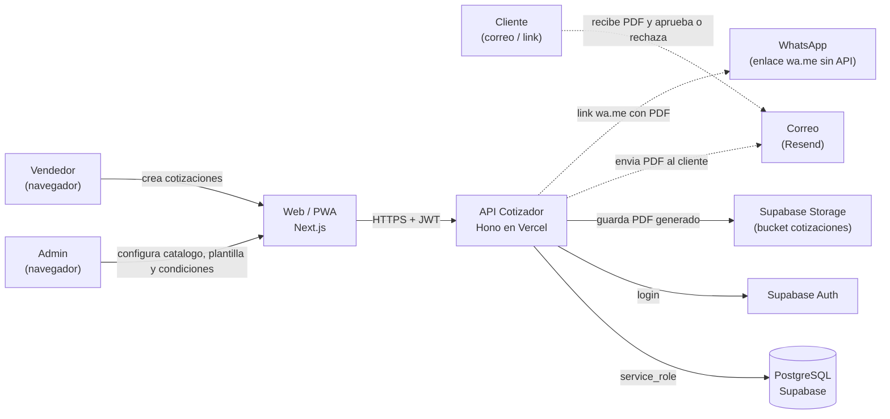
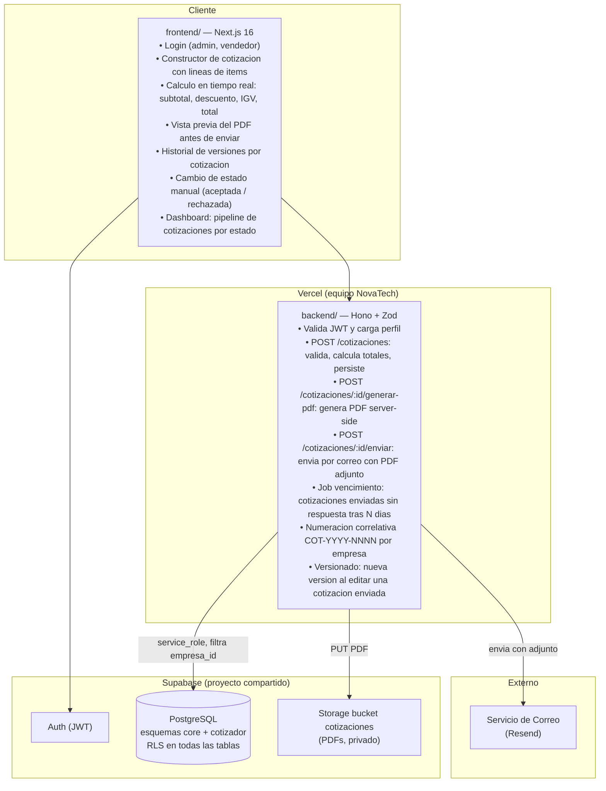
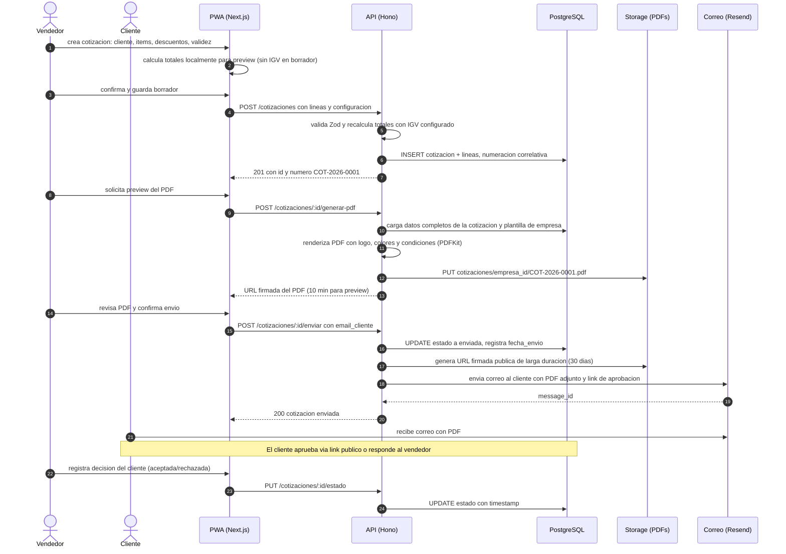
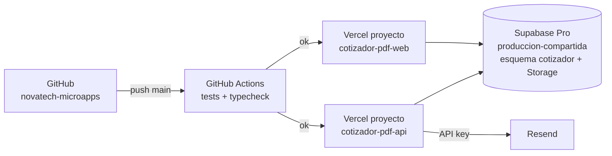

# 02 · Arquitectura — Cotizador con PDF

Los diagramas usan **Mermaid** (se ven directamente en GitHub y en VS Code con la extension "Markdown Preview Mermaid Support").

## 1. Contexto (C1)



## 2. Contenedores (C2)



**Principio clave:** el **PDF se genera en el servidor** (nunca en el navegador del vendedor) usando la plantilla con logo y colores configurados por la empresa. Esto garantiza que el cliente siempre recibe un documento con la marca correcta independientemente del dispositivo desde el que trabaje el vendedor.

## 3. Secuencia principal: creacion y envio de cotizacion



## 4. Diagrama de despliegue



| Componente | Proyecto Vercel | Dominio sugerido |
|---|---|---|
| API | `cotizador-pdf-api` (Root: `13-cotizador-pdf/backend`) | `api-cotizador.novatechconsulting.com.pe` |
| Web / PWA | `cotizador-pdf-web` (Root: `13-cotizador-pdf/frontend`) | `cotizador.novatechconsulting.com.pe` |
| Base de datos | Supabase `produccion-compartida` (esquema `cotizador`) | — |
| Storage | Supabase `produccion-compartida` bucket `cotizaciones` (privado) | — |

## 5. Decisiones de arquitectura (ADR)

| # | Decision | Alternativas | Motivo |
|---|---|---|---|
| ADR-01 | **PDF generado en el servidor** (PDFKit en Hono) | jsPDF en el navegador, Puppeteer | El servidor controla la plantilla con logo y colores del cliente; jsPDF en el browser no puede acceder a fuentes embebidas ni al logo almacenado en Storage privado. Puppeteer agrega 50-150 MB de binario a la funcion serverless. |
| ADR-02 | **Cotizacion enviada no editable** (se crea nueva version) (RN-02) | Edicion con historial de cambios | Cumple expectativa legal y comercial: el cliente recibio un documento especifico; si cambia, debe recibir uno nuevo con numero de version explicito (COT-2026-0001 v2). |
| ADR-03 | **IGV calculado en el servidor** con Zod, no en el cliente | Solo en el frontend | Evita discrepancias por redondeo entre lo que muestra el preview y lo que queda registrado; el servidor es la unica fuente de verdad del documento fiscal. |
| ADR-04 | **Vencimiento automatico via job** (Vercel Cron diario) | Solo estado manual | Una cotizacion vencida sin marcar como tal da informacion erronea al vendedor sobre el pipeline; el job garantiza el estado correcto sin accion humana. |
| ADR-05 | **Numeracion correlativa por empresa** guardada como sequence en DB | UUID como identificador publico | COT-2026-0001 es legible y trazable por el cliente; el UUID se mantiene como PK interno pero no se expone en el documento. |
| ADR-06 | **WhatsApp via enlace wa.me** (no Cloud API) | WhatsApp Business Cloud API | RF-06 especifica "sin costo de API"; wa.me genera un enlace precompuesto que abre WhatsApp con el texto del vendedor, sin requerir cuenta Business ni webhooks. |
| ADR-07 | **PDFs almacenados en Storage** (no regenerados cada vez) | Regenerar on demand | Garantiza que el documento enviado al cliente es identico al que se puede descargar meses despues; no hay riesgo de discrepancia por cambio de plantilla posterior. |

## 6. Estructura de codigo

```
13-cotizador-pdf/
├── backend/
│   ├── api/index.ts
│   ├── src/
│   │   ├── app.ts
│   │   ├── domain/
│   │   │   ├── cotizacion.ts          # calcularTotales, validarLineas, estadoPermitido
│   │   │   ├── numeracion.ts          # siguienteCorrelativo por empresa
│   │   │   └── version.ts             # crearNuevaVersion
│   │   ├── services/
│   │   │   ├── crearCotizacion.ts
│   │   │   ├── generarPDF.ts          # PDFKit + plantilla empresa
│   │   │   ├── enviarCotizacion.ts
│   │   │   └── procesarVencimientos.ts # job diario
│   │   ├── repos/
│   │   │   ├── CotizacionRepo.ts
│   │   │   ├── LineaRepo.ts
│   │   │   └── CatalogoRepo.ts
│   │   ├── routes/
│   │   │   ├── cotizaciones.ts        # POST, GET, PUT estado, generar-pdf, enviar
│   │   │   ├── catalogo.ts            # CRUD items con importacion CSV
│   │   │   └── admin.ts               # plantilla, logo, condiciones
│   │   ├── middleware/auth.ts
│   │   └── lib/
│   │       ├── supabase.ts
│   │       ├── storage.ts
│   │       ├── correo.ts
│   │       ├── pdf.ts                 # helpers PDFKit
│   │       └── errors.ts
│   └── tests/
├── frontend/
│   ├── app/
│   │   ├── login/
│   │   └── (panel)/
│   │       ├── cotizaciones/          # lista con filtros de estado
│   │       ├── cotizaciones/nueva/    # constructor con lineas
│   │       ├── cotizaciones/[id]/     # detalle, preview PDF, enviar
│   │       ├── catalogo/
│   │       └── admin/                 # plantilla y condiciones
│   ├── components/
│   │   ├── ConstructorLineas.tsx      # tabla editable de items
│   │   ├── ResumenTotales.tsx
│   │   ├── EstadoBadge.tsx
│   │   └── ui/
│   └── lib/
│       ├── api.ts
│       ├── calculos.ts                # preview local de totales
│       └── formato.ts
└── database/
    ├── migrations/20261028001300_cotizador.sql
    ├── seed.sql
    └── tests/rls_cotizador.test.sql
```
