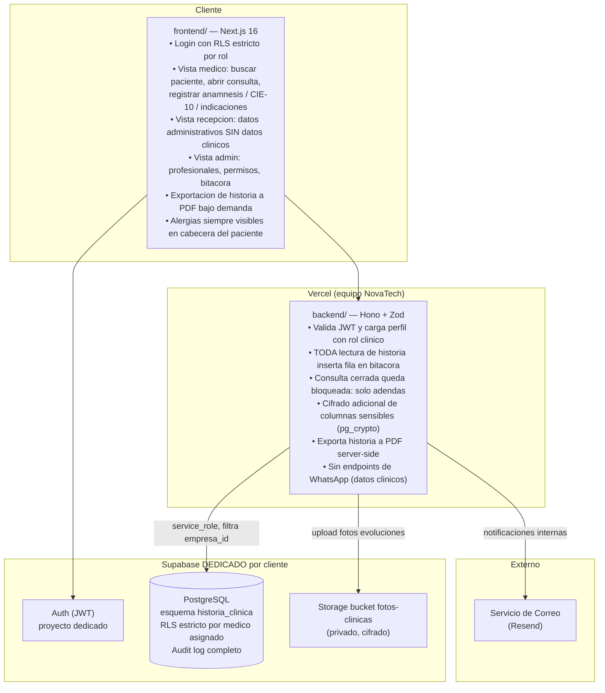
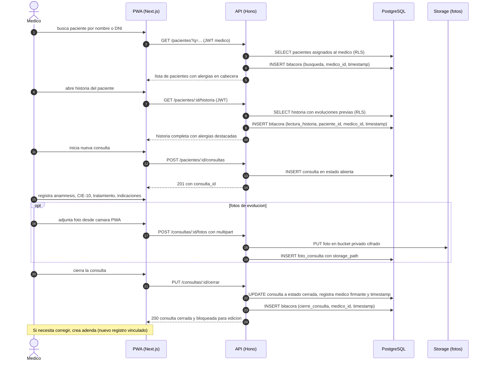
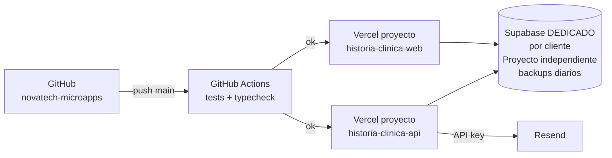

# 02 · Arquitectura — Historia Clinica Simple

Los diagramas usan **Mermaid** (se ven directamente en GitHub y en VS Code con la extension "Markdown Preview Mermaid Support").

> **Aviso de compliance:** Esta app maneja datos de salud clasificados como datos sensibles por la **Ley 29733** (Peru) en su nivel maximo de proteccion. Por ello se aparta de la norma del stack compartido en un punto critico: usa un **proyecto Supabase DEDICADO por cliente**, no el proyecto compartido. Todo lo demas sigue el stack estandar.

## 1. Contexto (C1)

```mermaid
flowchart LR
    MED["Medico / Profesional\n(navegador PWA)"] -->|registra y consulta historias| WEB["Web / PWA\nNext.js"]
    ENF["Enfermero\n(navegador PWA)"] -->|consulta y registra signos vitales| WEB
    REC["Recepcion\n(navegador PWA)"] -->|datos administrativos solo| WEB
    ADM["Admin Clinica\n(navegador)"] -->|gestiona profesionales y permisos| WEB
    PAC["Paciente\n(fisico)"] -.->|solicita exportacion de historia| WEB
    WEB -->|HTTPS + JWT| API["API Historia Clinica\nHono en Vercel"]
    API -->|service_role| DB[("PostgreSQL\nSupabase DEDICADO\npor cliente)"]
    API -->|login| AUTH["Supabase Auth\n(proyecto dedicado)"]
    API -->|fotos de evoluciones| STO["Supabase Storage\n(bucket privado cifrado)"]
    API -.->|notificaciones internas| MAIL["Correo\n(Resend)"]
```

## 2. Contenedores (C2)



**Principio clave:** **ningun dato clinico sale del perimetro de la API**. La recepcion tiene una vista dedicada que no expone historia ni diagnosticos. Toda lectura de historia queda registrada en la bitacora de accesos (RF-04); el RLS a nivel base de datos restringe a cada medico a ver solo los pacientes bajo su atencion.

## 3. Secuencia principal: apertura y cierre de consulta medica



## 4. Diagrama de despliegue



| Componente | Proyecto Vercel | Dominio sugerido |
|---|---|---|
| API | `historia-clinica-api` (Root: `14-historia-clinica/backend`) | `api-clinica.{cliente}.com.pe` |
| Web / PWA | `historia-clinica-web` (Root: `14-historia-clinica/frontend`) | `clinica.{cliente}.com.pe` |
| Base de datos | Supabase **DEDICADO** por cliente (esquema `historia_clinica`) | — |
| Storage | Supabase DEDICADO bucket `fotos-clinicas` (privado) | — |

## 5. Decisiones de arquitectura (ADR)

| # | Decision | Alternativas | Motivo |
|---|---|---|---|
| ADR-01 | **Proyecto Supabase DEDICADO por cliente** (no compartido) | Proyecto compartido con esquema separado | Datos de salud son datos sensibles nivel maximo (Ley 29733, RN-01); un proyecto dedicado garantiza aislamiento fisico de datos, backups independientes y una instancia PostgreSQL propia que no comparte recursos con otras empresas. |
| ADR-02 | **Audit log de TODA lectura en bitacora** (INSERT en cada GET de historia) | Audit log solo de escrituras | RF-04 y normativa de historias clinicas exigen saber quien accedio a que datos y cuando, no solo quien los modifico. |
| ADR-03 | **Consulta cerrada bloqueada para edicion, solo adendas** (RF-06) | Edicion con control de versiones | Un documento medico firmado no puede modificarse; las adendas preservan el registro original y agregan la correccion con fecha y firmante. |
| ADR-04 | **Cifrado de columnas sensibles** con pg_crypto en PostgreSQL | Solo cifrado en transito (TLS) | TLS protege el canal pero los datos en reposo en la DB quedan en claro; pg_crypto agrega una capa adicional para columnas con diagnosticos y medicacion. |
| ADR-05 | **RLS estricto: medico solo ve sus pacientes asignados** | Admin puede asignar acceso libre | Principio de minimo privilegio; un medico no debe poder ver historias de pacientes de otro colega salvo asignacion explicita por el admin. |
| ADR-06 | **Sin WhatsApp ni mensajeria externa para datos clinicos** | Notificaciones de resultados por WhatsApp | La Ley 29733 prohibe enviar datos de salud por canales no seguros; WhatsApp no ofrece garantias de cifrado extremo a extremo verificable para uso empresarial en Peru. |
| ADR-07 | **Recepcion tiene vista dedicada sin datos clinicos** | Un solo rol con campos ocultos en el frontend | El control de acceso en el frontend es insuficiente; la separacion de roles en la API y en RLS garantiza que la recepcion nunca recibe datos clinicos en ninguna respuesta. |

## 6. Estructura de codigo

```
14-historia-clinica/
├── backend/
│   ├── api/index.ts
│   ├── src/
│   │   ├── app.ts
│   │   ├── domain/
│   │   │   ├── consulta.ts            # estadosPermitidos, puedeEditar, crearAdenda
│   │   │   ├── bitacora.ts            # registrarAcceso, registrarLectura
│   │   │   └── cifrado.ts             # cifrarColumna, descifrarColumna (pg_crypto)
│   │   ├── services/
│   │   │   ├── abrirConsulta.ts
│   │   │   ├── cerrarConsulta.ts
│   │   │   ├── crearAdenda.ts
│   │   │   └── exportarHistoriaPDF.ts
│   │   ├── repos/
│   │   │   ├── PacienteRepo.ts
│   │   │   ├── ConsultaRepo.ts
│   │   │   ├── BitacoraRepo.ts        # SOLO INSERT, sin UPDATE ni DELETE
│   │   │   └── FotoRepo.ts
│   │   ├── routes/
│   │   │   ├── pacientes.ts           # GET busqueda, GET historia
│   │   │   ├── consultas.ts           # POST crear, PUT cerrar, POST adenda
│   │   │   ├── fotos.ts               # POST adjuntar, GET URL firmada
│   │   │   ├── exportar.ts            # GET /pacientes/:id/historia.pdf
│   │   │   └── admin.ts               # profesionales, permisos
│   │   ├── middleware/
│   │   │   ├── auth.ts                # JWT a perfil con rol clinico
│   │   │   └── auditLog.ts            # middleware que inserta en bitacora en cada request
│   │   └── lib/
│   │       ├── supabase.ts            # cliente service_role proyecto DEDICADO
│   │       ├── storage.ts
│   │       ├── pdf.ts
│   │       ├── correo.ts
│   │       └── errors.ts
│   └── tests/
├── frontend/
│   ├── app/
│   │   ├── login/
│   │   └── (panel)/
│   │       ├── pacientes/             # busqueda, historia completa (solo medico)
│   │       ├── consulta/[id]/         # formulario CIE-10, indicaciones
│   │       ├── recepcion/             # datos administrativos sin clinica
│   │       ├── bitacora/              # vista admin
│   │       └── admin/
│   ├── components/
│   │   ├── CabeceraPaciente.tsx       # alergias siempre visibles
│   │   ├── EditorConsulta.tsx
│   │   ├── AdendaBadge.tsx
│   │   └── ui/
│   └── lib/
│       ├── api.ts
│       ├── supabase.ts                # cliente proyecto DEDICADO
│       └── formato.ts
└── database/
    ├── migrations/20261028001400_historia_clinica.sql
    ├── seed.sql
    └── tests/rls_historia_clinica.test.sql
```
