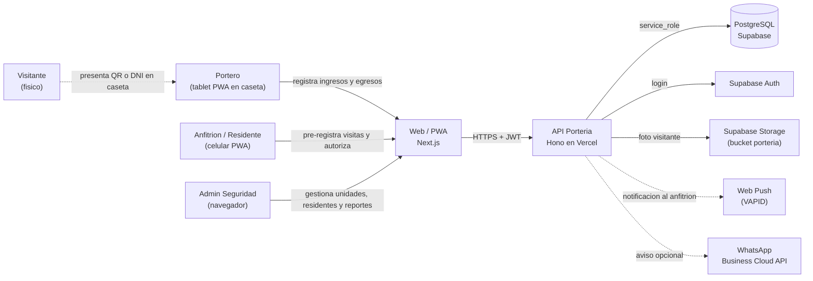
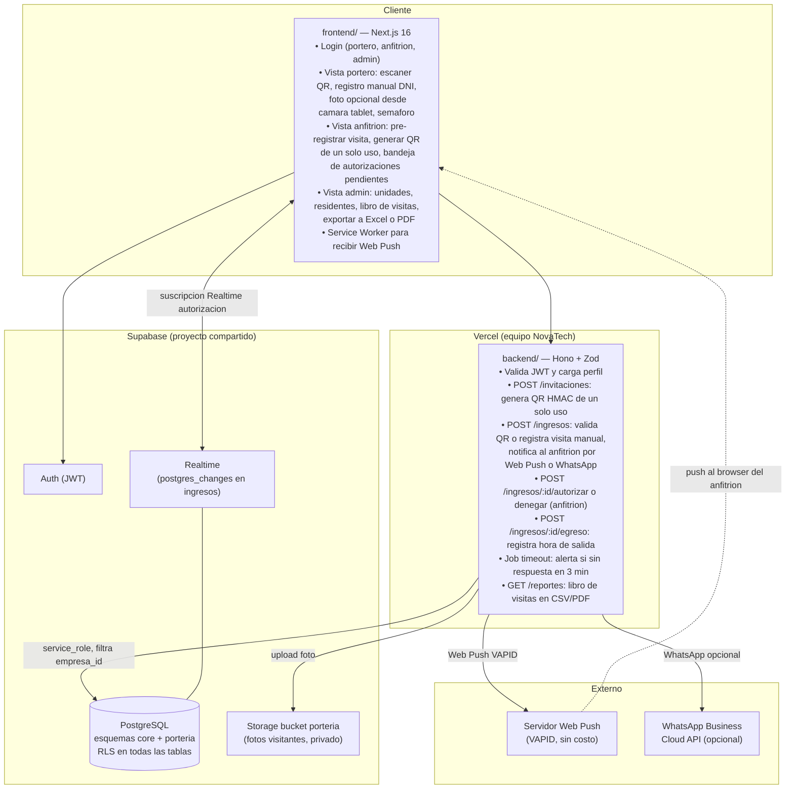
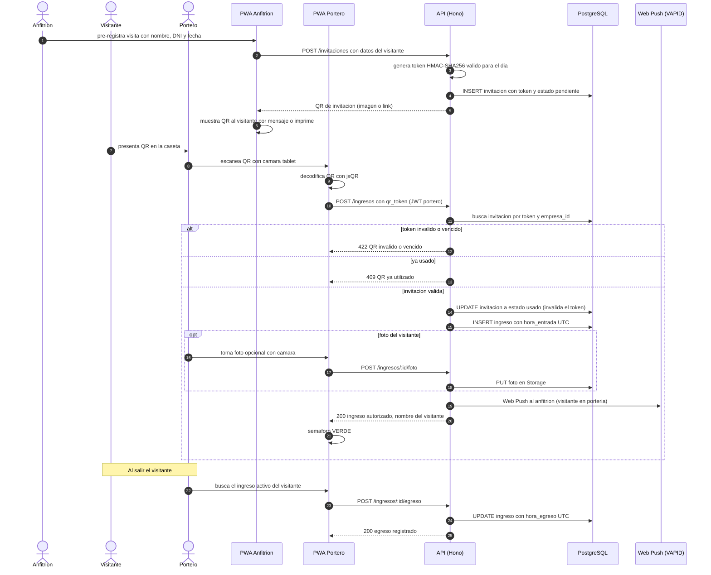
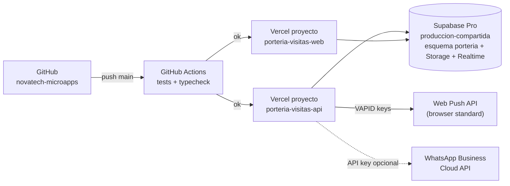

# 02 · Arquitectura — Registro de Visitas en Porteria con QR

Los diagramas usan **Mermaid** (se ven directamente en GitHub y en VS Code con la extension "Markdown Preview Mermaid Support").

## 1. Contexto (C1)



## 2. Contenedores (C2)



**Principio clave:** el **QR de invitacion es de un solo uso** (se invalida en la primera validacion exitosa). La decision de "dejar pasar" la toma el servidor, nunca el portero por su cuenta ni el cliente. Para visitas sin pre-registro el sistema notifica al anfitrion en tiempo real y bloquea el acceso hasta recibir autorizacion o que se cumpla el timeout de 3 minutos.

## 3. Secuencia principal: llegada de visitante con QR de invitacion



## 4. Diagrama de despliegue



| Componente | Proyecto Vercel | Dominio sugerido |
|---|---|---|
| API | `porteria-visitas-api` (Root: `15-porteria-visitas/backend`) | `api-porteria.novatechconsulting.com.pe` |
| Web / PWA | `porteria-visitas-web` (Root: `15-porteria-visitas/frontend`) | `porteria.novatechconsulting.com.pe` |
| Base de datos | Supabase `produccion-compartida` (esquema `porteria`) | — |
| Storage | Supabase `produccion-compartida` bucket `porteria` (privado) | — |

## 5. Decisiones de arquitectura (ADR)

| # | Decision | Alternativas | Motivo |
|---|---|---|---|
| ADR-01 | **QR de invitacion de un solo uso** (token HMAC-SHA256, UPDATE a usado en primer scan) | QR reutilizable por dia | RN-01 lo exige; un QR reutilizable puede fotografiarse y ser usado por terceros; el UPDATE atomico en DB previene doble entrada por race condition. |
| ADR-02 | **Web Push VAPID como canal principal de notificacion al anfitrion** | Solo correo, solo WhatsApp | Web Push es gratuito y de latencia baja (menos de 1 s); WhatsApp queda como canal opcional de respaldo para anfitriones que no instalen la PWA. En iOS la PWA debe estar instalada (RNF-08). |
| ADR-03 | **Supabase Realtime** para que el portero vea autorizaciones del anfitrion sin recargar | Sondeo cada N segundos | La respuesta del anfitrion debe llegar al portero en tiempo real para no dejar al visitante esperando; el sondeo agrega latencia innecesaria. |
| ADR-04 | **Foto del visitante opcional** (no obligatoria en MVP) | Obligatoria con reconocimiento facial | La camara PWA en tablet funciona en la mayoria de dispositivos; el reconocimiento facial requiere un servicio externo con costo y complejidad legal adicional. |
| ADR-05 | **Registro manual sin QR disponible** (portero ingresa datos, notifica al anfitrion) | Solo QR | RF-04 requiere cubrir el caso de visitante sin invitacion previa; la mayoria de visitas imprevistas son la norma, no la excepcion. |
| ADR-06 | **Job de timeout a los 3 min** (alerta al portero si no hay respuesta) (RN-02) | Timeout visual solo en el cliente | El portero no debe depender de que el cliente recuerde contar el tiempo; el servidor registra el evento y puede alertar a un supervisor si el anfitrion no responde. |
| ADR-07 | **Exportacion de libro de visitas en CSV y PDF** generada en servidor | Descarga desde el cliente | El volumen de visitas por mes puede ser alto; el servidor filtra por empresa_id y periodo sin exponer datos de otras instalaciones. |

## 6. Estructura de codigo

```
15-porteria-visitas/
├── backend/
│   ├── api/index.ts
│   ├── src/
│   │   ├── app.ts
│   │   ├── domain/
│   │   │   ├── qr.ts                  # generarTokenInvitacion (HMAC), verificarToken
│   │   │   ├── visita.ts              # estadoPermitido, calcularDuracion
│   │   │   └── notificacion.ts        # construirPayloadPush, construirMensajeWA
│   │   ├── services/
│   │   │   ├── crearInvitacion.ts
│   │   │   ├── registrarIngreso.ts    # valida QR o registra manual
│   │   │   ├── autorizarIngreso.ts    # accion del anfitrion
│   │   │   ├── registrarEgreso.ts
│   │   │   └── procesarTimeouts.ts    # job 3 min sin respuesta
│   │   ├── repos/
│   │   │   ├── InvitacionRepo.ts
│   │   │   ├── IngresoRepo.ts
│   │   │   └── FotoRepo.ts
│   │   ├── routes/
│   │   │   ├── invitaciones.ts        # POST, GET mi-qr
│   │   │   ├── ingresos.ts            # POST, PUT egreso, POST foto
│   │   │   ├── autorizaciones.ts      # POST autorizar o denegar
│   │   │   ├── reportes.ts            # GET libro-visitas CSV y PDF
│   │   │   └── admin.ts               # unidades, residentes, porteros
│   │   ├── middleware/auth.ts
│   │   └── lib/
│   │       ├── supabase.ts
│   │       ├── storage.ts
│   │       ├── webpush.ts             # wrapper web-push con VAPID
│   │       ├── whatsapp.ts            # opcional
│   │       └── errors.ts
│   └── tests/
├── frontend/
│   ├── app/
│   │   ├── login/
│   │   └── (panel)/
│   │       ├── porteria/              # escanear QR, registro manual, buscar egreso
│   │       ├── mis-invitaciones/      # vista anfitrion: crear, ver QR, autorizar
│   │       ├── reportes/              # libro de visitas
│   │       └── admin/
│   ├── components/
│   │   ├── EscanerQR.tsx              # jsQR en camara tablet
│   │   ├── SemaforoPase.tsx
│   │   ├── RegistroManual.tsx
│   │   └── ui/
│   ├── public/
│   │   └── sw.js                      # Service Worker para Web Push
│   └── lib/
│       ├── api.ts
│       ├── supabase.ts
│       ├── webpush.ts                 # suscripcion VAPID
│       ├── qrScanner.ts
│       └── formato.ts
└── database/
    ├── migrations/20261028001500_porteria.sql
    ├── seed.sql
    └── tests/rls_porteria.test.sql
```
